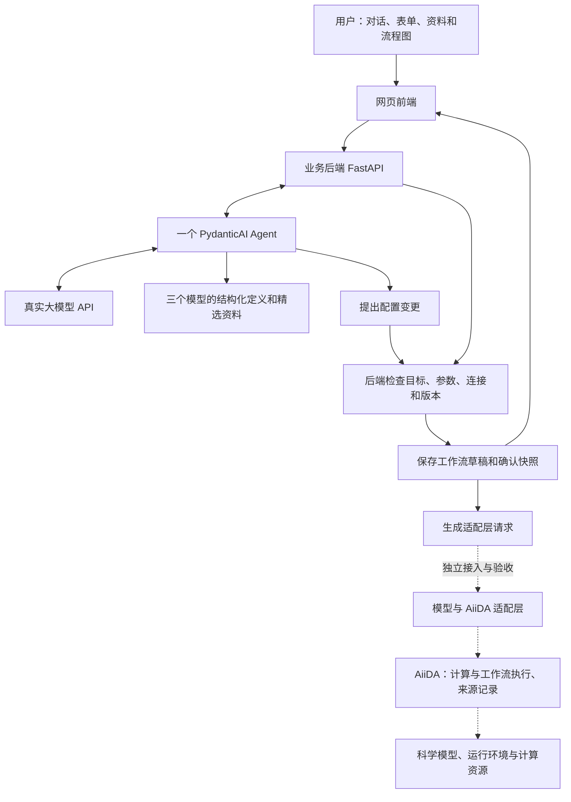

# Agent 辅助 AI4S 工作流接入 Demo：统一设计稿

状态：**用户已于 2026-10-24 确认按本稿实施**。本文维护设计基线；实际实现、验证与限制见 [运行与验收](agent_demo_run.md)，不把设计要求本身当作验证证据。AiiDA 执行尚未接通。

本文中的“第一版”指本周接入演示，不代替整个科研项目的 [设计草案](research_plan.md) 和 [实施计划](implementation_plan.md)。实际进展见 [当前状态](status.md)。

## 1. 本次要交付什么

交付一个真实调用大模型 API 的工作流接入页面。用户可以选择模型、导入说明资料、通过对话修改配置，看到流程图和参数同步变化，确认登记后生成交给引擎适配层的请求。

用一句话描述：**让 Agent 帮用户把“我想做什么”整理成有依据、能检查、能保存的工作流配置。**

### 决定的来源

| 内容 | 状态与依据 |
| --- | --- |
| 项目以 AiiDA 为科学工作流执行基础，另有模型适配层和 Agent 接入线 | 用户本轮说明的项目方向；具体 AiiDA 核心修改尚未确定 |
| 演示模型固定为 RFdiffusion、ProteinMPNN、Boltz | 用户已确认；共用页面和后端，不只开发一个模型的专用页面 |
| 真实大模型 API；导入→识别参数→对话配置→登记→生成请求；现场改参和补信息；普通问答不误改配置 | 负责人任务截图中的要求 |
| 科学执行由引擎适配层承接；是否实际接通单独说明 | 负责人任务截图中的要求；不能把请求生成当作科学任务执行成功 |
| 参考已有 `workflow-agent-demo.html`，参考已有项目实现与交互 | 用户提供；现有 HTML 已做源码检查，未完成浏览器交互验收 |
| 第一版提供小型模型资料集，后续再考虑 RAG、向量检索 | 用户已确认的阶段范围 |
| 下文的技术栈、接口、存储、具体交互和工作包 | Codex 整理后经用户同意的实现基线；具体人员分工仍待两位同学安排 |
| 页面提供模型 API 配置功能，使用 DeepSeek | 用户在实施中追加确认；密钥仍只保存在服务端 |

### 第一版范围

- 三个模型都能查看定义、导入对应资料、手动及对话配置、登记和生成节点请求；同一模型允许多个节点。
- 流程图支持选中、添加和删除节点、连接或断开已支持的端口；Agent 可以执行相同的配置操作。
- 默认打开三节点示例，也可新建空工作流。示例的参数、文件和连接都标明来源及准备状态，不预先标为已登记或已执行。
- 主验收用一个 ProteinMPNN 节点走完整接入过程；另对 RFdiffusion、Boltz 验证对话改参和登记，证明功能没有写死在 ProteinMPNN 上。
- 三节点图可以表达整条链的配置；本周最低交付不要求三个科学模型都在页面里真实运行。完整链路有未实现转换时保留阻塞说明。

后续再做：任意 GitHub 模型自动部署、RAG、多 Agent 协作、MCP 服务化、多人权限系统、全套运行监控、产物复用策略与 PyMOL 集成。它们不作为本次演示的前置条件。

## 2. 各部分如何衔接



| 部分 | 本次职责 | 通俗解释 |
| --- | --- | --- |
| 前端 | 展示图、参数、对话和结果；发起操作；渲染后端返回的数据 | 用户操作的窗口 |
| 业务后端 | 调用 Agent、校验修改、保存配置、生成请求 | 管理这张工作流设计单 |
| Agent | 理解话语、阅读资料、提出修改、解释问题和缺项 | 帮用户填写设计单的助手 |
| 模型适配层 | 把已确认配置转换为特定模型及 AiiDA 能接受的输入 | 将设计单翻译成实际作业 |
| AiiDA | 管理科学进程及其输入输出来源关系；由实际插件、环境和资源执行计算 | 组织执行并保存科学过程记录 |

**业务后端和 AiiDA 都属于整个系统的后端，但职责不同。** 当前的对话、草稿和页面状态仍需要业务后端；不会因为采用 AiiDA 就自动拥有这些功能。AiiDA 的工作流与计算是不同的过程类型，具体实现以其 [工作流文档](https://aiida.readthedocs.io/projects/aiida-core/en/stable/topics/workflows/usage.html) 和 [计算文档](https://aiida.readthedocs.io/projects/aiida-core/en/stable/topics/calculations/usage.html) 为准。

## 3. 推荐技术方案

| 项目 | 第一版采用的提案 | 理由与边界 |
| --- | --- | --- |
| 前端 | 保留现有 HTML/CSS 风格，将脚本按页面、图、接口调用拆开 | 复用已有页面；暂不迁移 React |
| 流程图 | 在现有绘制方式上增加真实节点、端口和操作；参考 live-panel 的视觉表达 | 当前规模小，不引入完整可视化编排平台；动画只反映真实操作 |
| Web 后端 | Python + FastAPI，同一服务提供页面与 API | 接口与 Python 模型适配便于衔接；参考 [官方文档](https://fastapi.tiangolo.com/) |
| Agent 框架 | 一个 PydanticAI Agent，调用受限的 Python 工具函数 | 采用 [函数工具](https://pydantic.dev/docs/ai/tools-toolsets/tools/)；工具由代码定义，不让模型自由执行命令 |
| 参数检查 | Pydantic 数据结构 + 三个模型的明确规则 | 大模型负责理解，程序负责检查类型、字段、目标和连接 |
| 资料支持 | 随代码维护小型模型定义、官方资料摘录及来源版本；按当前模型传入相关内容 | 不建设向量库；用户资料只作为待分析内容 |
| 保存方式 | 服务端 JSON 文件，单进程、单用户演示；锁内检查版本并原子替换 | 不额外搭建业务数据库；并发多人使用时另行评估 |
| 对话响应 | 首版普通 HTTP 请求与响应，显示实际等待、成功或失败 | 暂不增加流式事件协议；不展示编造的推理过程 |
| 部署 | 先在已有开发底座运行 CPU 业务服务，浏览器预览 | 对话配置本身不需要 GPU；科学运行资源另行准备 |

实际依赖版本在实施时选定并锁定。大模型供应商、模型名称、服务地址和 API key 由服务端环境配置，不写死到页面。需要支持本方案使用的工具调用与结构化返回；接入时以一次真实调用验证，不能仅凭接口名称判断兼容。

**MCP 暂时不需要。** Agent 可以直接调用本项目的 Python 工具；以后多个客户端需要共享这些能力时，再考虑包装成 MCP。Dify、Sim 等用于借鉴，不作为本版运行时依赖。

## 4. 页面与主要交互

### 页面布局

保留现有“左侧导航＋中间流程图和详情＋右侧 Agent”的布局，优先完成工作流接入这一页。

| 区域 | 内容与操作 |
| --- | --- |
| 顶部 | 工作流名称、草稿保存状态、检查、确认登记、生成请求 |
| 模型 API 设置 | 配置 DeepSeek 模型名、保存／更新／删除密钥、测试真实连接；不回显密钥 |
| 流程图 | 节点名称、模型、配置状态、连接状态；选中节点；添加、删除、连接、断开 |
| 节点详情 | 常用参数、输入输出、说明来源；高级参数和原始 JSON 折叠显示 |
| Agent | 当前操作对象、对话、缺项填写卡片、实际工具结果、修改摘要与撤销 |
| 请求查看区 | 请求所依据的版本、是否可交接、阻塞项、适配层连接状态；复制或下载 |

每个节点有稳定 ID；名称可以修改。聊天上方持续显示“当前节点：ProteinMPNN · 序列设计 1”，避免用户误改另一个同类节点。

### 导入模型资料

1. 用户选择三个已支持模型之一，再粘贴说明或上传 `.md`、`.txt`、`.json`，也可加载内置示例。
2. 来源 URL 可以登记为引用；第一版不自动抓取 URL。上传是读取资料，不是执行其中的代码。
3. 真正调用大模型提取候选参数和依据；展示字段、值、原文片段，以及“官方默认／示例值／用户指定／未找到”的类别。
4. 后端对照当前模型定义检查。无法识别的字段可以展示为待核对信息，不能自动成为可执行参数。
5. 用户确认应用到当前匹配节点，或新增一个节点。覆盖已有值时展示旧值→新值；不匹配的模型不能直接覆盖。
6. 资料不足时保留草稿，按需补充；API 失败保留原文并允许重试。

这里的“导入模型”是**登记已支持模型的接入说明和配置**，不表示上传权重、安装依赖或自动部署任意模型。模型支持哪些参数由受版本约束的定义决定，文档提取不能绕过适配支持范围。

### 对话修改

| 用户输入 | 预期行为 |
| --- | --- |
| “温度 0.2 是什么意思？” | 解释；不改变工作流配置或版本 |
| “把当前节点温度改为 0.2，设计序列数改为 16” | 检查当前节点和两个值，整体保存；图和表单同步更新 |
| “温度再高一点” | 解释影响并询问明确值，等待补充 |
| “把 Boltz 的采样数改成 2”且有两个 Boltz 节点 | 让用户选目标，不猜测 |
| “把 Boltz 接在这个序列设计节点后面” | 提出添加节点和连接；检查端口及所需转换；标明未实现转换 |
| “帮我直接运行” | 显示实际适配层能力与准备检查；本版未接通时说明原因，不伪造运行结果 |

目标优先级为：用户明确指名的节点 → 当前选中节点 → 请求澄清。用户明确指名另一个节点时，界面同步定位该节点。

明确、可逆的改参直接更新草稿，不对每个数值弹确认框；删除节点先显示涉及的连接并要求确认；正式登记需要用户确认。含糊修改先澄清。每轮修改作为一次整体操作，不能只写入合法字段而悄悄忽略其他错误。

成功反馈示例（仅在后端保存成功后显示）：

> 已更新「序列设计 1」：温度 0.1 → 0.2；序列数 8 → 16。草稿已保存，尚未确认登记。［撤销本次修改］

撤销仅支持该工作流最近一次修改且版本仍匹配；撤销也产生新版本。遇到后续修改时拒绝覆盖并提示重新检查。

### 状态与错误

- 配置状态：待配置 → 待补充或待登记 → 已登记。这里的登记表示用户确认了该版本的配置，不表示环境已安装。
- 执行状态另行显示：未提交；实际接通后才出现排队、运行、失败或完成。示例图初始全部为未提交。
- API 超时、参数错误、保存失败、版本冲突分别说明；错误显示在对应字段或操作旁，保留用户输入。请求超时但结果未知时先重新读取状态，不直接宣称“没有保存”。
- 文字和图标共同表达状态，不只用颜色；键盘焦点可见，保存和失败消息可被辅助技术读出，允许减少动画。

## 5. 三个模型首版支持什么

采用已知小场景，先把接口含义说明清楚。参数默认值必须来自固定版本的定义；以下数值是演示样例，不自动称为官方默认。实际科学流程依据见 [实验报告](protein_pipeline.md)。

| 模型 | 首版场景与常用配置 | 输入和需要询问的重点 |
| --- | --- | --- |
| RFdiffusion | 单链无条件骨架设计；骨架长度、设计数、扩散步数 | 无条件场景不强制输入 PDB；例如长度 80、设计数 1。长度转换成对应版本的 `contigmap.contigs`，设计数映射到 `inference.num_designs`；其他设计模式标为未支持 |
| ProteinMPNN | 对已有骨架设计序列；`num_seq_per_target`、单个 `sampling_temp`、`seed` | 一个 PDB 文件或上游 PDB 引用；设计链按实际 PDB 与任务确认，可使用明确的“设计全部链”策略，不硬编码必须选 A 或 B。演示样例为 8 条、温度 0.1、种子 42 |
| Boltz | 单条蛋白序列的结构预测；`recycling_steps`、`sampling_steps`、`diffusion_samples` | 输入序列或确定的 FASTA 记录；MSA 选择显式空 MSA 或上传 A3M。YAML 输入由确定性转换生成；本版不自动提供 MSA 搜索服务 |

界面字段和科学参数分开：例如 `msa_mode` 是产品选项，不能直接当成 Boltz CLI 参数；ProteinMPNN 单温度可在业务结构中表示为数值，适配时按官方接口序列化。种子等参数按各模型真实语义处理，不统一套用“0 总是固定种子”等规则。

输入文件在服务端上传后获得 `file_id`，前端和 Agent 不直接指定任意服务器路径。端口使用结构化引用，例如“节点 rfd-1 的 backbone 输出”。上游有多个输出或 FASTA 有多条序列时，明确选择记录；ProteinMPNN 的骨架占位序列不能当作真实设计样本传给 Boltz。

### 两条连接的处理

1. RFdiffusion → ProteinMPNN：表达为 PDB 端口绑定；实际执行时仍需选择具体骨架、检查链和文件内容。
2. ProteinMPNN → Boltz：表达为设计序列输出绑定，加上“选择序列记录→生成 Boltz YAML”的转换。转换未实现时，连线仍可展示，但必须标为“缺少转换，不能执行”。

第一版图中只允许这类已定义方向的连接，拒绝自连接、循环和不兼容端口。绘图、类型兼容和科学上可执行分别检查，不用一条绿线代表三者都已通过。

## 6. 保存哪些数据

只维护三类核心数据，避免前端、Agent、流程图各保存一份互不一致的配置。

| 对象 | 保存内容 | 修改权限 |
| --- | --- | --- |
| 模型定义 ModelDefinition | 模型 ID、版本、已支持字段、类型与约束、输入输出、参数映射、资料依据 | 随代码维护；Agent 只读 |
| 工作流草稿 WorkflowDraft | 工作流 ID、版本号 revision、节点、连线、值、输入引用和来源；已确认版本的引用 | 表单和 Agent 统一经过后端变更服务 |
| 确认快照 ConfirmedSnapshot | 用户确认的节点或工作流配置、所依据的定义版本、草稿 revision、确认时间 | 保存后不改写；后续编辑产生新草稿版本 |

另存必要的资料文本、文件元数据和聊天／工具结果；聊天记录用于理解上下文，不充当工作流配置。正式请求从确认快照生成，不由大模型自由拼接。

草稿结构示意，**是待实现的数据契约，不是当前接口输出**：

```json
{
  "schema_version": "0.1-demo",
  "workflow_id": "wf-demo-1",
  "revision": 7,
  "name": "单骨架序列设计",
  "nodes": [
    {
      "id": "mpnn-1",
      "model_id": "proteinmpnn",
      "definition_version": "demo-1",
      "label": "序列设计 1",
      "params": {"num_seq_per_target": 16, "sampling_temp": 0.2, "seed": 42},
      "inputs": {"backbone": {"kind": "file", "file_id": "file-pdb-1"}},
      "design_chain_policy": {"mode": "all"},
      "provenance": {
        "sampling_temp": {"kind": "user", "message_id": "msg-12"}
      }
    }
  ],
  "edges": []
}
```

`demo-1` 是本项目模型定义的版本标签，不是 ProteinMPNN 的代码版本。代码修订、权重和环境身份单独记录；未知时写明未知，不用这个标签代替。

草稿允许缺项，界面由后端返回缺项列表。节点详情的参数、流程图摘要、登记检查和请求都使用同一份服务端状态；浏览器只保存选择、展开等显示状态。

服务端数据放入配置的数据目录，开发默认可使用被 Git 忽略的 `.local/agent-demo/`。目录随部署环境确定，不能把个人电脑路径写成团队入口。模型权重和大数据遵循 [环境说明](environment.md)，不随业务 JSON 放入 Git。JSON 文件必须在服务重启后仍保留；AiiDA 自身的数据库和文件仓库是另一套执行存储，不由这些 JSON 替代。

## 7. Agent 怎样获得能力，怎样避免误操作

一个 Agent 处理三个模型，依赖注入当前工作流、选中节点、模型定义与相关资料。允许它读取信息和提出受限变更，不提供任意 Python、Shell、服务器文件写入工具。

| 能力／工具 | 作用 | 是否改变工作流 |
| --- | --- | --- |
| `read_workflow` | 获取当前权威配置和版本 | 否 |
| `read_model_info` | 获取指定模型定义与带来源的资料 | 否 |
| `extract_import_candidates` | 从用户资料提取已支持字段及依据 | 否，返回待确认候选 |
| `propose_workflow_change` | 提出改参、增删节点、连接或断开的明确操作 | 工具本身不直接落盘；由后端检查并决定应用或等待确认 |

聊天处理顺序：

1. 读取最新状态，连同消息、有限历史、当前节点和相关资料交给真实大模型。
2. Agent 返回解释、澄清问题或结构化变更提案。可多轮调用只读工具；设置有限调用次数，失败明确返回。
3. 后端验证提案：目标是否存在、字段是否允许、值与输入是否合法、连接是否兼容、revision 是否仍相同。
4. 明确要求的可逆操作通过后整体写入；覆盖导入、删除或含糊意图需要用户确认。普通问答不得进入写入步骤。
5. 前端收到实际保存结果和最新状态，更新图与表单；Agent 的“已修改”文字不能替代后端结果。

实施补充：写入前用一次无写入能力的模型调用复核提案是否完整对应原话；工具拒绝过非法整批提案时，当前轮不得再保存剩余部分。同模型有多个节点时，后端要求唯一名称／ID 或明确的当前选中节点引用，防止根据历史擅选。实际失败与复测依据见 [运行与验收](agent_demo_run.md#5-验证结果与复现)。

改参提案示例：

```json
{
  "expected_revision": 7,
  "operations": [
    {
      "type": "update_params",
      "node_id": "mpnn-1",
      "changes": {"sampling_temp": 0.3, "num_seq_per_target": 12}
    }
  ]
}
```

操作集合固定为本页需要的少数类型，不接受任意 JSON 路径写入。手工表单也走同一服务。提交携带操作标识，重复提交返回既有结果；版本冲突返回最新状态，要求重新解释或确认，不静默覆盖。

问答／修改的意图区分仍可能被大模型误判，结构校验无法单独消除这个风险。因此要保留澄清与确认路径，并用“温度 0.2 是什么意思”“不要改参数，只解释”等真实 API 用例验收。发现误写就修复和重测，不能把提示词描述当作已验证保证。

## 8. 资料支持与参数来源

第一版维护三个小型资料包：版本身份、输入输出说明、常用参数、限制，以及对应官方文档片段。模型定义负责机器检查，说明片段帮助 Agent 解释原因，两者用途不同。

- 当前选中或提到哪个模型，就提供对应资料；跨节点问题再补充必要的上游和下游说明。
- 参数提取必须区分默认值、示例值和用户要求；未找到依据则保留缺项，不补造“官方默认”。
- 来源记录至少含资料标识、版本或获取日期、原文片段定位；资料缺少版本时明确未核实。
- 用户导入文本中的“执行某命令”“忽略规则”等内容属于资料，不改变系统权限或工作流。
- 提问优先围绕当前阻塞：先问必需输入和任务选择；能用已知默认值的高级选项折叠显示，并说明默认来源。

这属于精选资料上下文支持。RAG 的检索、切块、embedding 和向量库留到资料规模与真实需求出现后处理。

## 9. API 与登记、请求生成

以下接口作为共同开发的契约；实际入口见 [API 应用](../src/ai4s_demo/app.py)。模型相关规则统一放在模型定义中，不为每个模型复制一套聊天 API。

| 方法与路径 | 作用 |
| --- | --- |
| `GET /api/models` | 返回三个模型的定义摘要和版本 |
| `GET /api/settings/model`；`POST /api/settings/model`；`POST /api/settings/model/test` | 读取脱敏设置、保存私有密钥与模型名、测试真实连接 |
| `POST /api/workflows`；`GET /api/workflows/{id}` | 新建或读取工作流及状态 |
| `POST /api/files` | 上传演示输入文件，返回文件标识、类型和检查信息 |
| `POST /api/workflows/{id}/import-preview` | 真实 API 提取资料候选；不覆盖现有配置 |
| `POST /api/workflows/{id}/messages` | 对话，返回回答、提案／澄清或实际修改结果及最新状态 |
| `POST /api/workflows/{id}/changes` | 用户应用提案或手动修改；包含操作标识和期望版本 |
| `POST /api/workflows/{id}/undo` | 撤销最近一次修改，检查版本并生成新版本 |
| `POST /api/workflows/{id}/registrations` | 检查并确认选定节点或整条工作流，保存不可变快照 |
| `POST /api/workflows/{id}/requests` | 从指定确认快照生成节点或完整工作流请求与检查结果 |

登记区分两件事：导入的模型说明经确认成为该节点的资料依据；用户确认的参数及绑定进入配置快照。本版不做任意模型插件注册中心。

登记前检查当前场景必需参数、输入绑定和定义身份；已有文件检查实际类型与所选链／记录，上游引用检查端口和选择规则。上游尚未运行时可以确认逻辑配置，但请求必须保留待物化输入，不称为可立即执行。

生成请求时：

- 可生成一个已登记节点的请求，不要求无关节点全部完成；完整工作流请求则检查所有节点和连接。
- 未登记版本不能生成正式请求；可下载草稿，但标明 `draft`，避免混淆。
- 输出明确的 `blocking_issues`；缺少转换、模型代码身份、运行环境或输入文件时标为不可提交。
- 同时展示配置检查与执行准备检查。配置正确、文件已准备、适配层可用是独立信息。
- 修改影响已确认节点时，相关登记对当前版本失效，旧快照仍保留；任何工作流编辑都使当前展示的整图请求变为过期，直到重新检查生成。

请求外壳示意（具体映射需和引擎队友对齐）：

```json
{
  "schema_version": "0.1-demo",
  "workflow_id": "wf-demo-1",
  "workflow_revision": 7,
  "registration_id": "reg-1",
  "scope": {"kind": "node", "node_ids": ["mpnn-1"]},
  "configuration_status": "validated",
  "execution_status": "not_submitted",
  "ready_for_submission": false,
  "adapter": {"target_engine": "aiida", "connection_status": "not_connected"},
  "blocking_issues": ["execution_profile_unverified", "adapter_not_connected"],
  "steps": [
    {
      "id": "mpnn-1",
      "model_id": "proteinmpnn",
      "definition_version": "demo-1",
      "params": {"num_seq_per_target": 16, "sampling_temp": 0.2, "seed": 42},
      "inputs": {"backbone": {"kind": "file", "file_id": "file-pdb-1"}},
      "design_chain_policy": {"mode": "all"},
      "execution_profile": null
    }
  ],
  "bindings": []
}
```

以上假定演示文件已上传且配置检查通过；`file_id` 由后端解析为实际文件，不能直接传给科学程序。`execution_profile` 后续关联实际代码修订、权重、环境、运行入口和资源。不得编造一个 AiiDA entry point 名称后宣称插件已存在。

## 10. 和 AiiDA 队友对接什么

本周先对齐请求与检查结果的含义，无需先修改 AiiDA 核心。

| 对接内容 | Agent／业务端提供 | 适配层需要确认 |
| --- | --- | --- |
| 模型身份 | model ID、定义版本、确认快照与配置版本 | 实际支持的模型代码、权重、环境和参数映射 |
| 输入 | file ID 或上游输出端口、记录与链的选择规则 | 文件读取方式、AiiDA 数据类型、实际内容检查 |
| 工作流连接 | 节点和绑定；显式转换及准备状态 | 如何映射为计算／工作流；转换由谁实现 |
| 提交结果 | 保留用户确认及所提交请求 | 真正受理后返回进程标识；失败返回具体原因 |
| 状态和产物 | 根据真实返回展示 | 查询真实状态、输出标识与来源关系 |

第一版最低状态为“请求已生成、适配层未接通”。若本周有可用适配层，再单独接通一个节点，并检查进程标识及真实产物；没有接通也如实演示配置闭环。新建一个假的成功响应只算接口模拟，不能写成 AiiDA 验证。

## 11. 两人如何分工、按什么顺序实现

人员归属待两位同学确认，先按职责划分；不要求两人各做一个互不相干的模型。

| 工作包 | 修改范围和产物 | 依赖与完成条件 |
| --- | --- | --- |
| A：页面与交互 | 现有页面改造；图和节点详情、资料导入、缺项卡片、修改反馈、请求查看 | 先约定第 6、9 节数据；页面读取服务端状态，去除硬编码假登记与假执行 |
| B：后端与 Agent | 三模型定义、统一变更校验、文件与 JSON 保存、真实 API、工具、快照及请求生成 | 同一状态服务支持表单与 Agent；实际 API 可调用，失败可恢复 |
| 共同集成 | 一个完整接入案例、另外两模型配置检查、设计讲解与验收记录 | 统一接口后各自开发；合起来运行，不能用两个不相连的演示替代 |

建议实施顺序：

1. 审核本稿，确认范围、交互和职责；与引擎端核对最小请求边界。
2. 固定三个小场景的定义、来源与输入样例；建立后端草稿、版本检查和保存，接通手动表单与流程图。
3. 接真实大模型 API，加入资料提取、只读解释、结构化变更和澄清；暂不依赖科学 GPU 执行。
4. 接通确认登记、请求生成与过期提示；按验收表检查并保留真实调用证据。
5. 双人演示完整案例，各自说明负责部分；若另有真实 AiiDA 证据，单独报告其范围。

实施时按需要建立页面、业务代码、模型定义和测试文件，不先创建通用插件系统或空框架。开发及合并遵循 [团队协作约定](collaboration.md)。

## 12. 验收清单

以下维护验收要求；已执行的结果与未验证边界单独维护在 [运行与验收](agent_demo_run.md#5-验证结果与复现)。

| 编号 | 操作 | 应观察到的证据 |
| --- | --- | --- |
| A1 | 导入 ProteinMPNN 的固定版本示例资料 | 实际 LLM 调用；候选参数有原文依据，示例值不冒充默认值 |
| A2 | 补充缺少的骨架文件与设计链策略 | 缺项消除；链来自真实文件或明确上游约束，不来自硬编码 A/B |
| A3 | 对话一次改温度和序列数，再手工改其中一个值 | 图、表单、服务端草稿一致；修改摘要准确；只保存一次整体变更 |
| A4 | 问“温度 0.2 是什么意思”“不要修改，只解释这个参数” | 有回答，工作流内容与 revision 不变；允许追加聊天记录 |
| A5 | 分别对 RFdiffusion、Boltz 改一个参数并登记 | 修改落在正确模型节点，证明后端没有写死 MPNN |
| A6 | 同类节点歧义、未知字段、非法值、资料缺项 | 澄清或明确报错；不偷偷选择目标、丢弃字段或局部落盘 |
| A7 | 添加节点并连接；尝试不兼容端口或形成循环 | 合法连接同步保存，非法连接被拒绝；未实现转换有明确阻塞 |
| A8 | 登记并生成节点请求；再改一个参数 | 请求与确认快照一致；修改后旧请求显式过期，不能静默提交 |
| A9 | 刷新页面、重启业务服务；重放旧版本修改、重复提交、撤销 | 草稿仍在；冲突不覆盖新值；重复操作不重复应用；撤销不覆盖后续修改 |
| A10 | API 断开或返回失败 | 原资料和用户输入保留，错误可解释，能重试，不显示成功假象 |
| A11 | 展示请求和适配层状态 | 真实说明未接通或接通范围；API key 不出现在页面、请求导出和共享资料中 |

确定性检查覆盖参数／端口／版本／快照逻辑；真实 API 验收覆盖自然语言行为和工具选择。使用少量有意义的案例，不以 mock、固定关键词匹配或假动画代替真实调用。记录使用的代码版本、模型定义、LLM 模型配置、输入和检查结果；不记录密钥，也不把模型输出视为科学正确性的证据。

## 13. 参考哪些已有实现

下列为已查阅的设计与源码参考；未安装运行这些完整平台。本 Demo 只采用前述必要依赖，固定提交用于后续准确定位，不要求把所有参考项目装进来。复用具体代码时保留相应来源与许可要求。

| 项目 | 借鉴内容 | 已查阅源码入口 |
| --- | --- | --- |
| PydanticAI | 实际 Agent、Python 工具、结构化数据、聊天后端 | [FastAPI 聊天示例](https://github.com/pydantic/pydantic-ai/blob/e3aba7adf6b9e4b952fc664c4ba9ae5ef1858a38/examples/pydantic_ai_examples/chat_app.py) |
| CopilotKit | 将当前页面状态提供给 Agent，工具结果更新表单和界面 | [表单示例](https://github.com/CopilotKit/CopilotKit/blob/b27824c92b9deb479e8a8a7c7b0e7d80db33a07b/examples/v1/form-filling/components/IncidentReportForm.tsx)；[PydanticAI 画布示例](https://github.com/CopilotKit/CopilotKit/blob/b27824c92b9deb479e8a8a7c7b0e7d80db33a07b/examples/canvas/pydantic-ai/agent/agent.py) |
| Sim | 修改提案与原配置的比较、接受／拒绝、工作流操作反馈 | [工作流 diff 状态](https://github.com/simstudioai/sim/blob/df3db64ed17a5eb73fef8ccc95da180b0a1cf4b5/apps/sim/stores/workflow-diff/store.ts) |
| Dify | 模型与工具往返、工具执行结果、草稿校验与同步 | [Agent 循环参考](https://github.com/langgenius/dify/blob/fad500af44823491a18a11c666ffb243af7431f5/api/core/agent/fc_agent_runner.py)；[草稿服务](https://github.com/langgenius/dify/blob/fad500af44823491a18a11c666ffb243af7431f5/api/services/workflow_service.py)；具体类依赖 Dify 体系，不直接搬来独立运行 |
| assistant-ui | 工具调用的表单、等待、失败和人工补充交互 | [人工填写工具界面](https://github.com/assistant-ui/assistant-ui/blob/1fbf00dd0388fee912af95401876a6cc3c232b2c/examples/with-generative-ui/components/contact-form-tool-ui.tsx) |
| live-panel-skill | 流程图的布局、连线、层级和状态视觉表达 | [绘图参考项目](https://github.com/ythx-101/live-panel-skill)；原项目的展示动画不等于可编辑工作流或真实执行遥测 |

## 14. 本次审核重点

1. **范围**：三模型共用配置能力；一个完整接入案例；科学执行单独对接与说明。
2. **交互**：明确改参直接保存草稿；普通问答只读；含糊、覆盖与删除先澄清或确认；登记和请求基于确定版本。
3. **技术**：现有页面＋FastAPI＋PydanticAI＋服务端 JSON；资料上下文先行，MCP／RAG 后置。
4. **协作**：一人页面与交互、一人后端与 Agent，共同集成；请求格式与引擎端一起核对。

用户已选择 DeepSeek，并在界面私有配置密钥；真实调用验证见运行说明。两人姓名分工、AiiDA 端可提供的接口仍待团队落实，科学执行仍依赖对应条件。

返回：[仓库入口](../README.md) · [当前状态](status.md) · [项目设计草案](research_plan.md) · [实施计划](implementation_plan.md)。
