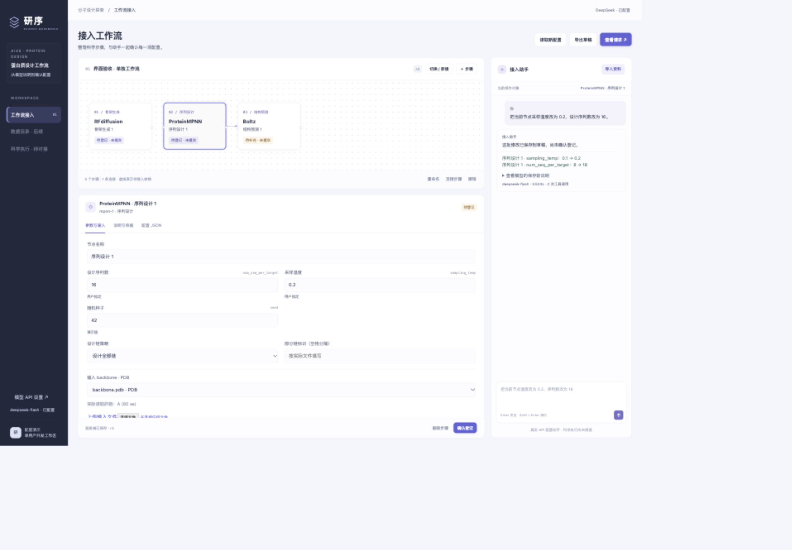
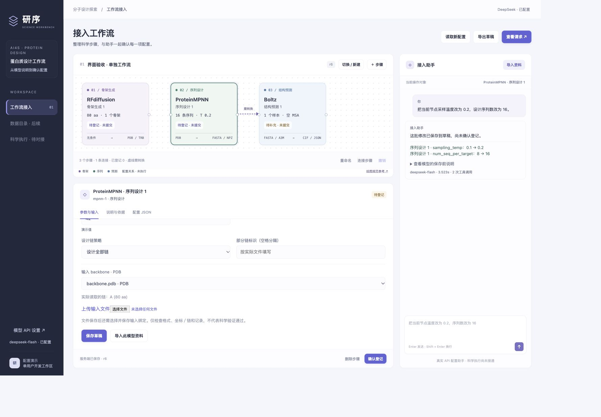

# AI 辅助生成：运行与验收

当前入口于 2026-10-29 按用户要求整合到「工作流 → 接入自定义流程 → AI 辅助生成」，独立导航与页面已移除。初版依据 [设计稿](agent_demo_design.md) 实施；单用户配置演示，科学执行与 AiiDA 尚未接通。

## 1. 启动

在仓库根目录执行，使用 Python 3.12 或更高版本与 `uv`：

```bash
uv sync --frozen
uv run python scripts/run_agent_demo.py
```

浏览器打开 [工作台](http://127.0.0.1:3000)，进入「接入自定义流程 → AI 辅助生成」。服务端口可通过 `--port` 调整，停止服务使用所在终端的 Ctrl+C。

### 与工作台共用 Coder 预览

在个人工作区仓库根目录执行（先按原方式停止本人已有的 3000 端口服务）：

```bash
uv sync --frozen
uv run python scripts/run_agent_demo.py --host 127.0.0.1 --port 3000
```

AI 功能直接嵌入工作台的接入页，手动与 AI 模式共用原导航和页面外壳。旧 `./agent/` 链接跳转至 `#/workflows/new?mode=ai`，不再呈现独立 UI。工作台在 3000 端口代理仅监听回环地址的 Agent 服务（默认 3002），页面和 API 路径兼容 Coder 预览前缀。联合进程退出时一起停止服务，不需要修改 Coder 模板或新增预览入口。

工作台模拟快照继续使用用户状态目录中的 `ai4s-workbench-demo/api-state`；Agent 使用独立的 `.local/agent-demo/`，不会自动转换或覆盖原工作台快照。可分别通过 `--workbench-data-dir` 与 `--data-dir` 指定。此模式不启动 PyMOL；PyMOL 依赖和联合服务仍需另行准备。

服务没有独立账号系统，按单用户、个人 Coder 开发预览使用。新部署不会携带本机私有 API key、工作流或输入文件，请在目标预览的「模型 API 设置」配置 DeepSeek。工作区停止后需重新启动服务；服务与数据可用不代表科学执行或 AiiDA 已接通。

## 2. 配置 DeepSeek

1. 在「接入自定义流程 → AI 辅助生成」点击工具栏的「模型 API 设置」。
2. 填写模型名称和 API key，点击「保存设置」。留空密钥表示保留原值；删除需显式勾选。
3. 点击「测试已保存配置」。成功表示真实连接和结构化工具返回已通过，不表示科学模型已运行。

默认 `deepseek-flash`、地址 `https://api.deepseek.com`；模型名可以在界面改，当前仅接入 DeepSeek 服务商。采用非思考模式、非流式返回。选择依据为 2026-10-24 查阅的 [DeepSeek 首次调用](https://api-docs.deepseek.com/) 和 [工具调用文档](https://api-docs.deepseek.com/guides/tool_calls/)；接口实现通过 [PydanticAI 的 DeepSeek provider](https://pydantic.dev/docs/ai/models/deepseek/)。

密钥仅保存在服务端私有配置或环境中，页面不回显，也不放入工作流、请求导出、聊天上下文或浏览器 localStorage。服务端保存文件权限为 `0600`。不要把私有数据目录提交 Git。

也可在进程环境提供 `DEEPSEEK_API_KEY`、`DEEPSEEK_MODEL`，或使用被 Git 忽略的 `.local/agent-demo.env`。界面保存后使用服务端保存值；删除界面密钥会保存空值，不重新回退到环境中的旧密钥。无需修改 Coder 自身的 `.env`。

## 3. 建议演示顺序

1. 打开三节点示例，选中 ProteinMPNN；图、参数和助手上下文应指向同一节点。
2. 点击「导入资料」，选模型并粘贴说明，或点击「填入示例」。识别会调用真实 API；原文、分类与旧值→新值可核对后确认应用。
3. 在节点详情上传真实 PDB，在 backbone 输入中选择它；选择设计全部链，或按实际文件的链标识选择部分链，然后保存草稿。文件上传和输入绑定是两个操作。
4. 问“温度 0.2 是什么意思，不要修改参数”，检查配置版本不变；再说“把当前节点温度改为 0.2，序列数改为 16”，检查保存摘要和表单。
5. 确认登记该节点；在「查看请求」中选择当前节点，生成请求，检查参数与输入。请求应明确 `not_submitted`、`ready_for_submission: false`，并给出未连接的适配层与未核验环境。
6. 修改参数后，原请求显示过期；需要重新确认相关配置并生成。可用「撤销」恢复最近一次修改；刷新、服务重启后草稿仍在。

已有输入可使用仓库中的 [R001 骨架 PDB](../experiments/R001-protein-design-smoke/evidence/backbone.pdb)，它是真实历史产物，链检查可读到 A 链、80 个残基。上传检查只覆盖有限格式与内容规则，不替代 ProteinMPNN 的完整输入准备。

直接用上游输出时，应指定记录选择意图，例如骨架 `0`、设计序列 `sample=1`；适配层仍需在真实产物上解析和核验。Boltz 直接序列输入与 FASTA 单记录绑定也支持；已有 A3M 会检查首条查询序列一致性。FASTA→Boltz YAML 转换与科学执行尚未接入。

### 将 AI 配置用于接入表单

点击「应用到接入草稿」并确认后，进入手动表单继续核对。已填写的项目信息保留，步骤按 AI 图的串行依赖排序；参数、输入引用、模型定义及原始连接作为 AI 配置快照保存。项目路径、环境、输入输出路径和调用指令不猜造；必须补齐后才能通过原接入检查。参数变化后，不会自动沿用之前核对的旧指令。

AI 草稿与接入草稿分别保存，回填是显式复制一个版本快照；手动编辑不会反向改写 AI 草稿。分支、循环、未连接的多节点不会被强行展平，仍可在 AI 模式保存、导出与生成引擎请求。当前实现的 Shadow DOM 仅用于隔离组件样式和同名控件，不是新的安全边界或 iframe。

## 4. 代码分工与数据

| 入口 | 职责 |
| --- | --- |
| [启动脚本](../scripts/run_agent_demo.py) | 单进程服务启动；默认仅绑定本机 |
| [API 应用](../src/ai4s_demo/app.py) | 模型、文件、设置与工作流 API；内部命名空间为 `./agent/api/` |
| [数据契约](../src/ai4s_demo/models.py) | 明确操作类型与请求字段，拒绝未知字段 |
| [模型目录](../src/ai4s_demo/catalog.py) · [模型资料](../src/ai4s_demo/knowledge/) | 三个模型的支持范围、参数与依据；上限为演示限制 |
| [配置服务](../src/ai4s_demo/service.py) · [存储](../src/ai4s_demo/storage.py) | 校验、整体保存、版本、撤销、登记、请求和原子 JSON 保存 |
| [Agent](../src/ai4s_demo/agent.py) | 真实 DeepSeek 调用、受限工具、提案完整性复核、目标范围检查 |
| [API 设置](../src/ai4s_demo/settings.py) · [输入检查](../src/ai4s_demo/files.py) | 服务端密钥管理；PDB、FASTA、A3M 的有限检查 |
| [内嵌面板](../src/ai4s_demo/web/workspace.html) · [组件控制器](../src/ai4s_demo/web/app.js) · [图](../src/ai4s_demo/web/graph.js) | 原生组件嵌入工作台接入页，无独立菜单或 iframe；样式和控件事件限定在组件内部 |
| [接入草稿转换](../web/demo/assets/agent-registration.js) | 保留步骤、参数、输入引用及原始连接；只对完整串行链回填，缺失部署信息不伪造 |
| [依赖声明](../pyproject.toml) · [版本锁](../uv.lock) | 本 Demo 的业务依赖；不包含蛋白质科学模型环境 |

默认数据目录为 `.local/agent-demo/`；可通过启动参数 `--data-dir` 或 `AI4S_DEMO_DATA` 更改。其下分别保存工作流 JSON、输入文件与元数据、私有 API 配置。工作流包内包含草稿、消息、工具结果、变更事件、导入候选、快照和请求；浏览器 localStorage 仅记录当前工作流 ID。

同一数据目录只允许一个服务进程，启动锁会拒绝第二个进程；服务内部加锁检查 revision 并原子保存。该实现不支持多 worker 或正式多人共享。工作流列表包含独立验收数据，不会覆盖用户原有工作流；失败验收记录也保留。

## 5. 验证结果与复现

### 当前入口整合验证（2026-10-29）

- 本地与 Coder 的 37 项 Python 检查通过；既有前端检查及新增接入草稿转换检查通过，覆盖参数身份、依赖排序、原项目信息保留、非串行图拒绝和旧指令失效。
- 本地浏览器验证了手动／AI 切换、未保存表单保留、参数回填及刷新持久化；实际 CSS 宽度约 1138 和 433 时没有整页横向溢出。
- Coder 新入口显示正常，既有 4 份 AI 草稿及 API 配置保留。独立「入口整合验证 2026-10-29」草稿经新组件真实调用 `deepseek-flash`：解释性问题保持 r0，随后仅将 RFdiffusion 的 `length` 从 80 改为 90，保存为 r1，其余参数不变。该验证未提交科学计算，原工作流的选中状态已恢复。

### 确定性检查

```bash
uv run pytest tests/test_agent_demo.py tests/test_protein_design_pipeline.py -q
```

初版 **27 项通过**，其中本 Demo 18 项、既有科学流程脚本 9 项。当前 main 同步后的检查范围另见下方部署记录。Demo 检查包括整体保存、非法字段和类型、版本冲突、重复操作、撤销、快照不改写、请求过期、真实 PDB 的链信息、FASTA 记录、A3M 查询一致性、资料证据、密钥不回显、重启持久化、单进程锁和模型模拟返回的处理。

测试中的 `TestModel` 仅验证集成机制，不作为真实语言理解证据。

### 真实 API 验收

```bash
uv run python scripts/verify_agent_demo.py --live --output .local/agent-demo-live-report.json
```

该命令调用已保存的真实 API，消耗账号额度；创建独立测试工作流，不执行科学计算。先启动服务并配置可用密钥。源码入口：[真实验收脚本](../scripts/verify_agent_demo.py)。

2026-10-24 21:24:22–21:24:58（Asia/Shanghai），最终一轮使用 `deepseek-flash` 完成 **13 项通过**，包括连接与结构化返回、资料识别与原文依据、数字问答只读、批量改参、补充链策略、快照与请求一致、跨模型修改、含糊要求澄清、非法批量不局部写入、多节点目标歧义、明确只问不修改、旧请求过期。该轮记录 24 次模型请求、149357 个输入 token 和 3064 个输出 token；不是性能基准或费用估算。

共享证据见 [验收摘要与文件身份](assets/agent-demo/acceptance-20261024.json)。开发中保留了以下失败，未改写为通过：

- 第一轮：用户要求两项一起修改且其中一项非法，模型只提交合法部分。加入无写入权限的完整性复核，并记录被工具拒绝的整批提案，拒绝后不得以删掉非法项的方式继续保存。
- 第二轮：非法批量场景返回 HTTP 502，CLI 中断，已保存摘要停在前 9 项通过；当时非法提案通过工具异常触发模型重试。随后改为结构化返回校验失败、要求澄清，并由后端记录拒绝；后续复测通过。该轮摘要本身不包含外部异常的完整诊断。
- 第三轮：有两个 Boltz 节点时，模型沿用历史上下文擅选第一个。加入确定性目标范围检查：同类多节点必须以唯一名称／ID 指定，或明确引用当前选中节点。
- 页面检查：温度输入框的 min 与 step 不对齐，使示例值无法通过浏览器校验。修正步长并通过实际保存、登记和生成请求核对。

这些修复提升了本次案例的行为约束，不能证明任意自然语言都不会误判。完整性复核仍调用大模型；字段、范围、版本、明确节点标识和保存结果由程序检查。

另完成 4 项补充集成检查：RFdiffusion 和 Boltz 各自登记及生成节点请求；真实 Agent 新增 ProteinMPNN 节点并连接上游；真实 Agent 删除请求先产生待确认提案，确认后删除且可撤销。它们单列在共享证据中，不计入上述 13 项脚本结果。

### 页面检查

已在浏览器检查三节点显示、独立工作流创建、实际文件上传与链信息、手工批量保存、刷新持久化、真实资料提取及覆盖确认、真实对话修改、登记确认和最终请求。有效 CSS 宽度 1778 与 463 时页面无整体横向溢出，流程图自身可横向滚动；截图及具体范围见共享验收证据。页面内确认框替代原生 confirm，以展示具体操作内容。保存反馈由实际后端结果决定，模型生成的保存前说明折叠展示。



### 工作台整合验证（2026-10-25）

同步 main 后，Agent 19 项（含预览子路径回归检查）、流程脚本 10 项、工作台 API 8 项共 **37 项确定性检查通过**；既有 6 项前端模拟检查与 API 客户端检查通过。实际启动联合服务检查了工作台入口、Agent 静态资源与 HEAD、同源创建和改参、持久化、跨站写入拒绝、真实历史 PDB 上传。首次整合暴露子路径静态资源定位问题，修正代理与内部服务的 `/agent/` 挂载前缀后复核通过。未再次调用付费 DeepSeek API，历史真实语言验收与本次部署检查分别判断。

### 个人 Coder 部署验证（2026-10-25）

已将代码同步到个人 Coder 的 `dev-ckz` 并启动后台联合服务，工作台原首页与 Agent 共用已有开发预览。部署所测代码基线为 [`47f6e74`](https://github.com/QUHONGYE-gif/ai4s-workspace/commit/47f6e747334f12f73e49845910becc0e945a20eb)，使用 Linux Python 3.12.15，按 `uv.lock` 安装项目专用 `.venv`，未安装科学模型或使用 GPU。

- Coder 内上述 **37 项 Python 检查全部通过**；JavaScript 逻辑检查在本机执行，Coder 未安装 Node.js。
- 已在真实 Coder 预览验证首页入口、三模型节点、返回链接、批量改参保存与刷新持久化。独立的「Coder 部署核验（非科学运行）」工作流将 ProteinMPNN 设为 16 条、温度 0.2、全部链和上游记录 0，保存为 r1；原示例保留。
- 联合进程在后台运行；日志和 PID 位于用户状态目录的 `ai4s-workbench-demo/server.log`、`server.pid`。Agent 的 JSON 与私有设置仍在独立数据目录，停止工作区后需按第 1 节重新启动。
- **首次部署验证时，目标环境尚未配置 DeepSeek API key，该轮没有在 Coder 重跑真实 LLM 验收。** 本机私有密钥和历史工作流没有随 Git 传入；在目标页面的「模型 API 设置」配置后才能使用对话与资料识别。历史真实 API 验收、本轮部署验证与科学执行分别判断；AiiDA 仍未接通。

### live-panel-skill 的实际使用范围（追加调整）

初版仅查阅了该项目的说明，流程图自行实现，未执行其完整 skill 工作流。用户指出后，重新阅读 [SKILL.md](https://github.com/ythx-101/live-panel-skill/blob/main/SKILL.md)、[motion grammar](https://github.com/ythx-101/live-panel-skill/blob/main/references/motion-grammar.md) 和 [config schema](https://github.com/ythx-101/live-panel-skill/blob/main/references/config-schema.md)，对现有交互画布做视觉适配：

- 浅色角色配色与图例：骨架、序列、预测分别表达；选中时保持底色并突出边框。
- 节点显示输入输出格式、参数摘要；连接显示 PDB 或待接入转换，选中依赖同步突出。
- 节点与图例中的数量、参数和状态来自同一服务端配置；仅在观察到真实保存的新版本时短暂反馈，不循环模拟科学任务运行。

该 skill 原文将自身定位为固定布局的循环动画／视频展示，并明确不适合交互或真实遥测。因此本次是**绘图规范的参考适配**，没有执行其 scaffold／视频渲染／逐帧检查流程，也没有将其模板作为交互编辑器。页面提供参考项目链接；没有复刻其示例作者的原图。

本次检查了 JavaScript 语法、桌面与窄屏布局、图例可见性，以及独立验收工作流中序列数 16→17→撤销恢复 16 时图与表单的一致性。后端代码身份保持与前述验收一致，未再次消耗 DeepSeek API。追加证据见 [图形层检查记录](assets/agent-demo/panel-reference-20261024.json)；上面的初版截图及原验收记录保留。



### 队友分支画布同步（2026-10-25）

本次合入 `dev-zjx` 的 `6cee154`，采用其阶段外框、节点图标、连线和流动点／图标弹跳样式。其余 Agent 后端及 Coder 预览适配保持原实现。流动点与弹跳是配置依赖的示意动画，页面继续标注「未执行」，不代表科学模型已运行或数据已真实传输；本次未调用 DeepSeek 或提交科学任务。合并后的 37 项 Python 检查、既有前端逻辑检查及 JavaScript 语法检查通过。Coder 真实预览中的三节点、连线和选中详情正常，检查时没有浏览器控制台错误；既有草稿与对话保留，页面显示 DeepSeek 已配置。本次只读核对配置状态，未读取密钥或重新调用 API。

### 侧栏与聊天排版修复（2026-10-25）

侧栏改为固定视口高度并可独立滚动，避免主内容超高后页面底部出现白块。助手消息支持受限的段落、列表、强调、行内代码及代码块；参数名按已有模型定义突出显示，历史消息同步改善，用户原文与保存记录不改写。消息中的原始 HTML 与链接仍作为文本显示，不允许执行。

37 项 Python 检查及既有前端检查通过；新增消息排版检查覆盖列表、参数、代码块和 HTML 转义。本地实际浏览器在页面滚动至底部、1024×600 与 390×844 视口检查侧栏和整页溢出，结果正常。该变更只涉及展示，本次没有调用 DeepSeek 或修改模型配置。

## 6. 端口画布

当前画布的操作方式、JSON 协议、分支／反馈关系和执行限制统一见 [工作流画布](workflow_canvas.md)。

本轮 39 项 Python 检查及现有前端检查通过，新增检查覆盖只读预览、分支绑定、辅助产物关联、原子失败、布局不改变科学登记、删除节点清理关系，以及复杂图不被串行回填。浏览器通过批量操作构建五节点分支和两条反馈／参考关系，核对鼠标拖动保存、刷新恢复、平移、缩放、聚焦、展开、环形布局与窄屏工具入口；实际窄屏 CSS 宽度为 433px，无整页横向溢出或控制台错误。Coder 上同样通过 39 项 Python 检查；真实 DeepSeek 分别完成 `set_layout(circle)` 和 Boltz `confidence` → RFdiffusion 的 `add_relation(feedback)`，调用后核对科学参数、输入和两条原始绑定均未改变。独立「端口画布验收 2026-10-29」草稿补充为五节点分支示例，原有五份草稿与密钥配置保留。仅为配置与界面验证，未运行科学模型。

## 7. 交接边界

目前已形成「资料→真实 Agent→配置草稿→用户确认登记→请求」闭环。API 设置可在页面完成。**没有科学任务提交入口，不执行 Shell，不存在已接通的 AiiDA 插件。**

下一次对接由引擎适配层确认代码／权重／环境身份、输入物化、格式转换及真正提交协议；拿到真实进程标识与产物后再单独验收。正式多人部署、MCP、RAG 和产物复用研究仍按原计划另行推进。

返回：[设计稿](agent_demo_design.md) · [当前状态](status.md) · [环境说明](environment.md) · [仓库入口](../README.md)。
