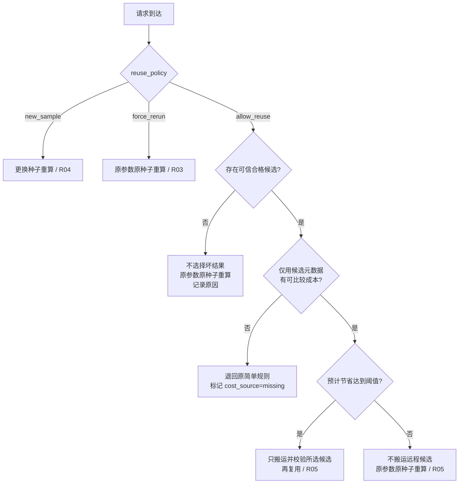

# 按成本决定复用还是重算

本文说明开发任务 5.0 中吴昱慧负责的成本决策扩展。这里比较的是预计墙钟时间成本，不是金额。实现只替换 `allow_reuse` 下的候选选择，不改变用户对 `force_rerun` 和 `new_sample` 的选择。

投屏页面：[成本决策原理可视化](cost_decision_visual.html)（流程图、四路径、公式、真实数据算例和 R008 验收结论）。

演示讲稿：[投屏演示讲稿](cost_decision_speech.md)（逐段口述、三个现场演示步骤和可能追问）。

真实运行记录：[R008 成本决策真实验收](../experiments/R008-cost-decision/record.md)。

## 结论与边界

- 已验证：在单个真实 Coder／AiiDA Profile 和真实 CPU ProteinMPNN 下，成本复用、成本判定重算、新采样、失败候选拦截六项检查全部通过；来源实测 `49.9s`、`34287B`，成本复用与默认复用均未创建 CalcJob，成本重算和新采样各创建 1 个真实 CalcJob。证据见 [R008](../experiments/R008-cost-decision/record.md#真实验证结果)。
- 已验证：纯决策逻辑、配置校验、R005 历史数据上的复用／重算切换、候选预选与搬运失败降级、未物化候选排除及决策记录接口由 `tests/test_cost_decision.py` 覆盖，当前离线回归 32 项通过。
- 工作假设：R008 的 `0.733s` 复用耗时仍是公式估算；默认搬运带宽和物化开销是可配置的工程参数，不是 ProteinMPNN 的实测标定值。
- 未验证：未证明跨机器或更大产物一定节省，也未证明成本策略优于 LRU；Lotaru 类预测模型尚未接入。

## 成本公式

候选的 `elapsed_s` 作为重算时间。若候选没有实测的 `reuse_elapsed_s`，则复用时间按下面的透明估算式计算：

```text
重算时间 = elapsed_s

复用时间 =
    transfer_fixed_seconds
    + size_bytes / transfer_bytes_per_second
    + materialization_seconds

预计节省 = 重算时间 - 复用时间
```

仅当 `预计节省 > 0` 且 `预计节省 >= min_savings_seconds` 时选择复用。多个合格候选同时可用时，选择预计节省最大的候选；节省相同时保留原候选顺序中的第一个。

如果候选提供实测的 `reuse_elapsed_s`，则直接使用该值，不再用搬运参数估算。所有参数字段和允许范围如下：

| 字段 | 含义 | 默认值 |
| --- | --- | --- |
| `enabled` | 是否启用成本决策 | `false` |
| `transfer_fixed_seconds` | 每次读取／搬运的固定开销 | `0.5` 秒 |
| `transfer_bytes_per_second` | 搬运带宽假设 | `1048576` B/s |
| `materialization_seconds` | 结果恢复为可消费输入的开销 | `0.2` 秒 |
| `min_savings_seconds` | 至少节省多少秒才复用 | `1.0` 秒 |

示例配置见 [reuse-cost-policy.example.json](../configs/reuse-cost-policy.example.json)。默认值用于建立可测试的基线，不能表述为 Lotaru 论文或本项目的模型效果。

候选还可以携带以下可选成本字段：

| 字段 | 含义 | 默认与约束 |
| --- | --- | --- |
| `elapsed_source` | `elapsed_s` 的来源 | `measured`／`estimated` 可参与比较；`missing` 表示缺少可用成本。本地旧记录未带此字段时按 `measured` 兼容；跨成员旧记录未标注来源时按 `estimated` 处理并保留 `elapsed_origin_source=unknown` |
| `reuse_elapsed_s` | 已实测或另行估算的复用耗时 | 提供后不再使用搬运公式；必须为非负有限数 |
| `reuse_elapsed_source` | `reuse_elapsed_s` 的来源 | 默认 `measured`，也可为 `estimated` |

所有候选都缺少可比较成本时，退回原有简单规则，并在原因中写 `cost_source=missing`。只有部分候选缺少成本时，只比较数据完整的合格候选，并在原因中记录跳过的数量；这避免一个坏字段让全部候选失去可比性。

## 成本来源与降级

| 来源 | 当前口径 | 决策记录 |
| --- | --- | --- |
| `measured` | 本机非零进程墙钟时间；或提供了实测的 `reuse_elapsed_s` 且对应来源为 `measured` | 两项都实测时写 `cost_source=measured` |
| `estimated` | 跨成员／跨 profile 的历史耗时，或复用时延由固定开销、大小和带宽参数估算 | 写 `cost_source=estimated`，并分别写重算／复用来源 |
| `missing` | 缓存命中、耗时未知、`elapsed_s` 不是正数、大小无效或来源字段非法 | 缺可靠成本时退回原有简单规则，并在原因中写 `cost_source=missing` |

R005 的历史候选数据为 `elapsed_s=31`、`size_bytes=2022`，离线测试仍用它验证公式和决定翻转。它属于历史数据上的纯逻辑回归，不是本轮真实运行。

R008 使用当前环境的真实来源候选：`elapsed_s=49.9`、`size_bytes=34287`。按默认参数，复用约为 `0.5 + 34287 / 1048576 + 0.2 ≈ 0.733` 秒，预计节省约 `49.167` 秒；真实 WorkChain 96 因此选择复用，未创建 CalcJob。把固定开销调到 `60s` 后，复用预计约 `60.033s`、节省 `-10.133s`；真实 WorkChain 109 因此选择重算并产生 1 个 CalcJob。两个结果都写入了 R05 决策记录，见 [R008 证据](../experiments/R008-cost-decision/evidence/real-run-3.json)。

`size_bytes` 当前是所有正式产物的未压缩总大小；跨成员搬运还要经过归档、校验和导入，真实开销可能高于公式估计。`build_candidate` 对本机非零进程墙钟时间写 `elapsed_source=measured`，缓存命中或未知耗时写 `missing`。远程候选进入请求方前会由 `prepare_remote_candidate` 将 `measured` 改为 `estimated`，并在 `elapsed_origin_source` 保留原标记，避免把源机器实测误当成目标机器预测；旧候选完全没有来源字段时同样按估计值处理，并记录 `elapsed_origin_source=unknown`。调用方若改放当前环境的预测值，也应显式写 `elapsed_source=estimated`。

## 四条路径



失败、运行中断、结果检查不通过、产物缺失或人工否决的候选会先被 `qualified=false` 排除，不能因为“预计节省很大”而被复用。成本策略只在 `allow_reuse` 下生效；`force_rerun` 和 `new_sample` 完全交给原有路径，`new_sample` 的种子在服务端生成并保持一致。

启用成本策略时，服务端先基于候选元数据决策，只物化最终选择复用的远程候选。若该候选搬运或校验失败，会立即标为不合格并重新选择；判定重算时不会提前搬运任何远程候选。预选结束后，所有仍未在本地物化的远程候选都会被标为不可复用，防止 daemon 读取到不同策略版本后引用不存在的本地结果。模型身份无法确定时，即使 AiiDA 给出了哈希命中的原生候选，也会强制重算。

## 启用方式

1. 复制示例配置为部署专用文件，把 `enabled` 改为 `true`。策略文件不要提交个人绝对路径。
2. 让网页服务和 AiiDA daemon 都设置同一个绝对路径：

   ```powershell
   $env:AI4S_COST_POLICY_FILE = "D:\path\visible\to\engine\reuse-cost-policy.json"
   ```

3. 重启服务及 daemon，使两边都读取新配置。
4. 在决策查询中检查 `reason_text` 是否包含 `cost_source`、`rerun_source` 和 `reuse_source`。

未设置 `AI4S_COST_POLICY_FILE` 时不安装成本决策函数，保持原 R01/R02/R03/R04 行为。配置了文件但读不到、JSON 非法、字段未知、数值为负或非有限数时会报配置错误，不能静默降级成另一种策略。WorkChain 不会吞掉决策函数加载失败：如果提交时指定了 `decision_function`，daemon 端必须能导入它并使用同一份策略，否则请求应显式失败而不是悄悄改走原规则。单任务请求若提交时已启用成本策略，会把 `cost_decision_required=true` 写入上下文；daemon 看不到可用策略时同样显式失败，不会静默退回默认候选顺序。

单任务路径由 [decisions.py](../src/ai4s_engine/decisions.py) 在缓存选择回调中安装策略；两阶段路径由 [service.py](../src/ai4s_engine/service.py) 先做候选预选，再仅向 `allow_reuse` 的 WorkChain 传入 `decision_function`，由 daemon 按同一口径生成最终 R05 记录。两种路径都依赖服务进程和 daemon 能看到同一份策略文件。远程候选按 peer 显示名回查唯一配置项，因此部署时成员名必须唯一；重名会安全失败，不会误路由到其他成员。

## 与 Lotaru 的关系

Lotaru 关注异构基础设施上的工作流任务运行时间预测，提醒我们：历史耗时依赖机器、环境和工具版本，预测值必须与实测值分开，数据不足时不能假装预测可靠。本实现借用这些原则，但当前没有训练 Lotaru 式预测模型，而是使用可审计、可回退的简单时间比较。

当前成本器不会自动把其他机器或环境上的 `elapsed_s` 归一化到本机。项目中的候选必须先通过同一科学请求匹配，因此输入规模和参数已经相同；但跨成员或换机器时，若历史耗时不可比，调用方应提供面向当前环境的 `elapsed_s` 估计并设置 `elapsed_source=estimated`，或提供实测的 `reuse_elapsed_s`，否则只能把结果视为带偏差的工程估计。默认参数以及 R005／R008 的单条来源记录都不足以证明跨机器预测精度。

后续若要提升预测质量，应先由曲鸿烨补齐排队、计算、检查和读取各阶段耗时，再按模型、输入规模、机器和环境版本积累样本；在数据量和误差尚未验证前，不应把论文中的误差数字或本模块的默认参数当作本项目结论。

## 验证命令与真实验收

离线回归：

```powershell
$env:PYTHONPATH = "src"
& "D:\Download\Python\python.exe" -m unittest tests.test_cost_decision -v
```

当前结果为 **32 passed**。语法检查使用 `python -m py_compile` 覆盖验证脚本和相关源码。

真实入口为 [verify_cost_decision_real.py](../scripts/verify_cost_decision_real.py)，最终证据为 [real-run-3.json](../experiments/R008-cost-decision/evidence/real-run-3.json)（SHA-256 `5d4ba067d8342620c2c29c784f42229015f89497e60e1a1e5718707dd37711c6`）。R008 在同一个真实 Profile 下验证了：来源候选非缓存实测、默认 R01 复用零 CalcJob、成本 R05 复用零 CalcJob、成本 R05 重算一个 CalcJob、新采样一个 CalcJob，以及失败候选 `qualified=false` 后安全重算一个 CalcJob。完整命令、原生过程 UUID、失败尝试和限制见 [R008 运行记录](../experiments/R008-cost-decision/record.md)。

本次真实验收只覆盖成本决策函数所在 WorkChain／daemon 执行路径；服务端预选、搬运失败后重选和未物化候选排除仍由单元测试覆盖，不能表述为已经完成跨成员真实集成验收。

返回：[C 模块](../README_C.md) · [当前状态](status.md) · [仓库](../README.md)。
