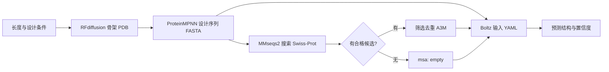

# 蛋白质设计流程跑通记录与使用说明

整理：陈铠洲；更新：2026-10-21。本文用于团队了解已完成工作、检查中间产物和接手运行。代码与附件位于个人开发分支 **[`dev-ckz`](https://github.com/QUHONGYE-gif/ai4s-workspace/tree/dev-ckz)**，尚未经团队会议批准合入 `main`。产物复用的协作讨论另见 [第二份文档](protein_reuse.md)。

## 1. 本次完成了什么

已在独立租用的 RTX 4090 上部署模型并跑通 **RFdiffusion → ProteinMPNN → 本地 MSA 搜索 → Boltz-2**，保留输入、中间产物、输出与日志，并封装为一条运行命令。验证范围为 **80 残基、无条件、单链、一个骨架、一条设计序列**。

| 任务要求 | 本次完成情况 | 可核查证据 |
| --- | --- | --- |
| 部署模型和虚拟环境、真实生成结构 | 已完成；前两步与 Boltz 分用两个 Conda 环境 | [R001 环境与运行记录](../experiments/R001-protein-design-smoke/record.md) |
| 构建简化 MSA 搜索库 | 已用 Swiss-Prot 建库，天然蛋白阳性对照的 MSA 已接入 Boltz 并完成预测 | [R002 记录及附件](../experiments/R002-swissprot-msa/record.md) |
| 理解参数与中间产物 | 本文第 3、5、6 节；保留扩散轨迹、序列概率、MSA 与预测置信度 | 各运行记录及 `evidence/` |
| 封装 pipeline 并真实验证 | 已完成，包含 MSA 无命中处理和产物检查 | [运行脚本](../scripts/protein_design_pipeline.py)、[配置](../configs/protein_design.matpool.json)、[R003](../experiments/R003-pipeline/record.md) |
| 与曲鸿烨共同梳理复用与加速 | 已形成讨论材料，**待双方讨论确认**；没有测得加速比 | [复用与加速协作讨论稿](protein_reuse.md) |
| 补充 GPU 版 MMseqs2 搜索路径 | GPU 独立分支已完成建库、两种查询、MSA 与 Boltz 预测；新增 pipeline GPU 入口仍待单独验收 | [R004 实验及附件](../experiments/R004-mmseqs-gpu/record.md)；本文第 4.4 节；官方参数说明见 [MMseqs2 GPU 搜索文档](https://github.com/soedinglab/MMseqs2/wiki#gpu-accelerated-search) |

两次新设计序列在本次 Swiss-Prot 库和各自搜索条件下均无命中，因而其 Boltz 预测实际使用 `msa: empty`。天然蛋白对照验证的是“有 MSA 的文件连接和预测路径”。**本次没有验证目标功能、结合能力或实验稳定性，也没有证明 MSA 带来效果提升。**

## 2. 运行结果与证据怎么读

| 运行 | 输入与目的 | 已验证结果 | 解释边界 |
| --- | --- | --- | --- |
| [R001](../experiments/R001-protein-design-smoke/record.md) | 首次手工执行 80 aa 无条件单链设计 | 骨架、设计序列、Boltz 结构均生成；80 对 Cα 叠合 RMSD **0.827 Å**；`confidence_score` 0.8749 | 未固定 RFdiffusion/Boltz 种子；无 MSA；几何接近不等于功能成立 |
| [R002](../experiments/R002-swissprot-msa/record.md) | R001 设计序列与天然人血红蛋白 α 链 P69905，各自搜索同一库 | 设计 0 命中；天然对照 500 命中，A3M 501 条记录，并完成 Boltz 预测 | 500 为搜索设置上限；没有同一对象有/无 MSA 的效果对照 |
| [R003b](../experiments/R003-pipeline/record.md) | 用封装生成另一条 80 aa 设计，固定各模型种子 | 全流程约 **112.45 秒**；设计 0 命中；结构序列与设计完全一致；`confidence_score` 0.8672 | 已部署环境下的单次墙钟耗时，含预检和模型初始化；不含安装、下载及首次建库；本轮未算 RMSD |
| [R003 阳性补查](../experiments/R003-pipeline/record.md#msa-有命中分支的补充检查) | P69905 使用 R003 更严格的搜索及筛选条件 | 498 候选；去重后 464 条 A3M 记录，含查询；Boltz 解析成功 | 仅 CPU 搜索、筛选与解析，未对这个新 A3M 重跑 GPU 预测 |
| [R004 GPU 分支](../experiments/R004-mmseqs-gpu/record.md) | 复用 R003b 设计序列；P69905 作阳性对照 | 设计 0 命中并完成单序列预测；阳性 498 命中、467 条筛选 A3M，带 MSA 的 Boltz 预测成功 | 从序列处续接；未重跑上游；CPU/GPU 灵敏度与结果不同，不报告正式加速比 |

R003 不是 R001 的重复结构，也没有沿用 R001 的 RMSD。R003 的搜索增加了显式一致性、覆盖度筛选及去重，与 R002 原搜索条件不同。


图中蓝色半透明为 R001 的 RFdiffusion 骨架，橙色为 Boltz 预测结构。[逐残基 pLDDT 图](../experiments/R001-protein-design-smoke/figures/boltz-plddt.png) 和 [PyMOL 脚本](../experiments/R001-protein-design-smoke/visualize.pml) 同时提供；仓库中的两份 PDB 足以重新查看叠合，不需要个人电脑上的会话文件。

## 3. 每一步在做什么



**RFdiffusion：生成主链空间形状。** 本例只指定长度，不指定功能或结合靶标。骨架 PDB 中的甘氨酸是占位残基，不能当成最终设计序列。`.trb` 保存实际配置和映射等元数据，轨迹 PDB 保存逐步扩散坐标，用于理解中间过程。

**ProteinMPNN：为骨架选择氨基酸序列。** 输入是骨架坐标，输出是采样序列及评分/概率。FASTA 第一条是原骨架记录，第二条才是本次采样序列；脚本检查 `sample=1`、长度和残基字符，避免把全甘氨酸送给下游。它不证明序列一定按骨架折叠。

**MSA：多序列比对（Multiple Sequence Alignment）。** Swiss-Prot 是序列数据库，MMseqs2 是搜索和比对工具，A3M 是比对结果文件。这里先搜索相似序列，再按一致性、查询覆盖度和 E 值筛选、去重。MSA 可提供多条相关序列的进化信息；达到计算阈值仍需检查生物学合理性。新设计可能没有天然同源物，只有查询自身的一行 A3M 不等于找到了同源 MSA。

**Boltz-2：由序列及可选 MSA 预测结构。** 本例没有配体或功能约束，使用结构预测模式。保存预测坐标、整体置信度和 pLDDT/PAE/PDE 等输出；可与原骨架叠合做一致性检查。置信度是模型估计，不是实验结论。

## 4. 团队如何使用代码

### 4.1 仓库内容与前提

| 仓库路径 | 用途 |
| --- | --- |
| [scripts/protein_design_pipeline.py](../scripts/protein_design_pipeline.py) | 标准库控制脚本，调用已经部署的官方模型和 MMseqs2；提供 `run`、`build-db`、`register-db` |
| [configs/protein_design.matpool.json](../configs/protein_design.matpool.json) | R003 实际配置；固定源码和主要包版本，**其中路径是原租用环境路径，换环境必须调整** |
| [tests/test_protein_design_pipeline.py](../tests/test_protein_design_pipeline.py) | 无需 GPU 的数据连接边界检查 |
| [experiments/](../experiments/R003-pipeline/record.md) | R001/R002/R003 详细记录、小型原始附件和图表 |

脚本没有重写模型，也不是一键安装器。真实执行要求 Linux x86_64、已授权的 GPU、足够的数据盘空间、已安装的模型源码/依赖/权重、Boltz 数据资料和 MMseqs2。运行环境与存储边界由 [环境说明](environment.md#矩池云临时-gpu-试运行2026-10-21) 维护；版本和兼容修复见 [R001](../experiments/R001-protein-design-smoke/record.md#执行身份)。本次只证明该小案例能在单张 24 GB 4090 上运行，未测显存峰值，不将 24 GB 写成所有任务的最低要求。团队 Coder 尚不能视为已部署好的 GPU 环境。

准备好的数据根目录应有以下真实内容，其中 `src/` 为固定版本的官方仓库，不能用未审查的新版本替代：

```text
<AI4S_ROOT>/
├── src/RFdiffusion/             # 含 models/Base_ckpt.pt 及 SE3 依赖
├── src/ProteinMPNN/             # 含 vanilla_model_weights/v_48_020.pt
├── tools/mmseqs/bin/mmseqs
├── db/uniprot_sprot.fasta.gz
└── cache/boltz/                 # 模型权重与所需分子资料
```

### 4.2 调整路径并查看执行计划

先取得 `dev-ckz` 分支。以下命令均从**仓库根目录**执行；在终端先将 `AI4S_ROOT` 设为执行环境已分配的数据目录，将 `AI4S_CONDA_ROOT` 设为该环境的 Conda 安装目录。二者必须是实际绝对路径；JSON 不会自动展开环境变量。

```bash
python - "$AI4S_ROOT" "$AI4S_CONDA_ROOT" <<'PY'
import json, sys
from pathlib import Path
root, conda_root = map(Path, sys.argv[1:])
assert root.is_absolute() and conda_root.is_absolute(), "请先设置实际绝对路径"
assert root.is_dir() and conda_root.is_dir(), "目录尚未准备好"
c = json.loads(Path("configs/protein_design.matpool.json").read_text())
c.update(root=str(root), conda=str(conda_root / "bin/conda"),
         rfd_env=str(conda_root / "envs/rfd4090"),
         boltz_env=str(conda_root / "envs/myconda"))
c["msa"]["database"] = str(root / "db/swissprot")
(root / "pipeline-config.json").write_text(json.dumps(c, indent=2) + "\n")
PY

python scripts/protein_design_pipeline.py run \
  --config "$AI4S_ROOT/pipeline-config.json" \
  --out "$AI4S_ROOT/runs/team-design-001" --dry-run
```

若 Conda 环境名称或 GPU 编号不同，还需修改生成的配置。`--dry-run` 仅检查配置并显示计划，不检查模型安装、GPU 或数据库，也不创建运行目录。

### 4.3 准备数据库并正式执行

新环境先取得已核验的 Swiss-Prot 压缩 FASTA，来源、版本识别及大小见 [R002](../experiments/R002-swissprot-msa/record.md#执行身份与数据)。官方 `current_release` 会更新；要复用本轮身份，必须匹配 R002 记录的源文件 SHA-256，不能仅凭下载地址相同。

```bash
python scripts/protein_design_pipeline.py build-db \
  --config "$AI4S_ROOT/pipeline-config.json" \
  --fasta-gz "$AI4S_ROOT/db/uniprot_sprot.fasta.gz"
```

这会解压 FASTA、调用 `createdb`，保存源文件、工具及库文件的哈希；使用 CPU，不是建完整 `createindex` 索引。数据库前缀必须尚不存在。若使用来源明确、已经建好的 R002 库，可用 `register-db` 替代 `build-db`；它只登记来源，不能证明任意未知库与所给 FASTA 对应。

正式执行前检查 GPU、磁盘和已有任务；按执行环境的资源规则使用单卡。长任务先进入具名 tmux 会话，再在仓库根目录执行：

```bash
python scripts/protein_design_pipeline.py run \
  --config "$AI4S_ROOT/pipeline-config.json" \
  --out "$AI4S_ROOT/runs/team-design-001"
```

**每次必须使用新 `--out`。** 当前脚本不覆盖、不自动续算，也没有跨运行的科学结果缓存。源码版本或安装状态不符会停止；失败目录、清单及日志保留。调整参数后保存新配置、新运行编号，不能覆盖已完成证据。

无需模型环境即可执行代码边界检查：

```bash
python -m unittest discover -s tests -p 'test_protein_design_pipeline.py' -v
```

### 4.4 使用 GPU 版 MMseqs2 搜索

这条路径替换的是 MSA 搜索步骤，前后 RFdiffusion、ProteinMPNN 和 Boltz 不变。MMseqs2 官方 GPU 构建支持蛋白质序列搜索；GPU搜索需要独立的 GPU 二进制和经 `makepaddedseqdb` 转换的目标库。GPU 搜索本身通过 `--gpu 1` 开启，后续 `convertalis`、`result2msa`、`unpackdb` 仍由 MMseqs2 执行，当前记录不把这些导出步骤描述为 GPU 加速。

**官方要求**：预编译 GPU 包要求 Linux glibc ≥ 2.29、NVIDIA Driver ≥ 525.60.13；无需单独安装 CUDA Toolkit。GPU搜索支持 Turing，但官方称 Ampere 或更新架构可达到完整速度。GPU 后端固定在最高灵敏度，CPU 路径的 `-s 7` 不用于 GPU 搜索；其余 E 值、候选数和覆盖度筛选仍按配置工作。见 [官方安装与 GPU 搜索说明](https://github.com/soedinglab/MMseqs2/wiki)。

以下操作在**实际 GPU Linux 执行环境**进行。先检查资源并确认获准使用的 GPU：

```bash
nvidia-smi
ldd --version | head -n 1
```

获取官方 GPU 预编译包后，解压到数据根目录的独立位置（不要覆盖 CPU 版）：

```bash
mkdir -p "$AI4S_ROOT/tools/mmseqs-gpu"
# 将官方 mmseqs-linux-gpu.tar.gz 放在当前目录后：
tar -xzf mmseqs-linux-gpu.tar.gz -C "$AI4S_ROOT/tools/mmseqs-gpu" --strip-components=1
"$AI4S_ROOT/tools/mmseqs-gpu/bin/mmseqs" version
```

先复制实际配置并改 GPU 后端、数据库前缀和 GPU 二进制版本。`version` 输出必须逐字填入配置；保留独立副本，CPU 配置和已有数据库不动：

```bash
python - "$AI4S_ROOT/pipeline-config.json" "$AI4S_ROOT/pipeline-config-gpu.json" \
  "$AI4S_ROOT/tools/mmseqs-gpu/bin/mmseqs" <<'PY'
import json, subprocess, sys
from pathlib import Path
source, target, binary = map(Path, sys.argv[1:])
c = json.loads(source.read_text())
c["msa"]["backend"] = "gpu"
c["msa"]["database"] = str(Path(c["root"]) / "db/swissprot-gpu")
c["msa"]["mmseqs_version"] = subprocess.check_output([str(binary), "version"], text=True).strip()
target.write_text(json.dumps(c, indent=2) + "\n")
PY
```

在 GPU 配置下调用既有 `build-db`，从同一份 Swiss-Prot FASTA 生成普通 MMseqs2 数据库，再生成 GPU padded 数据库。构建耗时和存储由数据库大小决定；构建结果与 FASTA 哈希、二进制版本及 SHA-256、建库命令一并写入 `.source.json`。该步骤不会改写 FASTA、CPU 库或已有运行：

```bash
python scripts/protein_design_pipeline.py build-db \
  --config "$AI4S_ROOT/pipeline-config-gpu.json" \
  --fasta-gz "$AI4S_ROOT/db/uniprot_sprot.fasta.gz"
```

建库后核查 provenance、设备可见性及 dry-run，再用**新运行目录**启动完整 pipeline：

```bash
cat "$AI4S_ROOT/db/swissprot-gpu.source.json"
python scripts/protein_design_pipeline.py run \
  --config "$AI4S_ROOT/pipeline-config-gpu.json" \
  --out "$AI4S_ROOT/runs/team-design-gpu-001" --dry-run
python scripts/protein_design_pipeline.py run \
  --config "$AI4S_ROOT/pipeline-config-gpu.json" \
  --out "$AI4S_ROOT/runs/team-design-gpu-001"
```

GPU `run` 会在 manifest 中保存实际调用参数，搜索命令带 `--gpu 1` 且不传 CPU 灵敏度参数；也会校验运行二进制与 padded 库哈希。数据库需要通过此配置的 `build-db` 生成；`register-db` 不接受 GPU 库，以免把来源不明的 padded 文件登记成已验证来源。单次 Swiss-Prot 查询不要求常驻 `gpuserver` 或预建 `createindex`。

**验证状态与比较办法**：[R004](../experiments/R004-mmseqs-gpu/record.md) 已用独立审计脚本完成真实 GPU 搜索和两条下游 Boltz 分支，保留每步耗时、参数、文件清单与失败记录。上述新增 GPU `build-db/run` 封装入口通过本地命令构造与建库边界测试，未直接完成端到端验收；不要混淆两者。显存峰值、正式性能对照仍未测量。要比较 CPU 与 GPU，使用相同查询序列、同一 FASTA/数据库快照及相同筛选阈值，分别保存运行记录；检查命中数、候选标识、最终 A3M 和 Boltz 输入。CPU 与 GPU 的搜索/排序结果不可预先假定完全相同，性能提升也须实测后再报告。

## 5. 哪些参数要固定，哪些可以改

以下是 R003 的演示配置，不是各类蛋白设计的最优设置。对照时，应固定未研究的因素并记录改变项。

| 阶段／参数 | 当前值 | 修改的含义 |
| --- | --- | --- |
| 源码、依赖、权重、库快照 | 固定版本，保存哈希与环境清单 | 决定计算身份；升级后需重新验证 |
| `length` | 80 | 骨架和序列长度；增大会改变对象、计算与显存需求 |
| `rfd_seed` | 42 | 设置 `deterministic=True`、`design_startnum=42`；官方脚本以设计编号为种子 |
| `rfd_steps` | 50 | 扩散步数；减少可能改变质量，不能直接称无损加速 |
| RFdiffusion 轨迹 | 开启 | 保留 `Xt-1`、`pX0` 轨迹；增加存储 |
| `mpnn_model` | `v_48_020` | 骨架条件序列模型；换权重会改变设计条件 |
| `mpnn_seed`／`mpnn_temperature` | 42／0.1 | 控制随机采样及多样性；MPNN 的 seed=0 表示另选随机种子 |
| MPNN 数量／batch／backbone noise | 1／1／0 | 当前仅验证一条序列；多候选选择尚未封装 |
| `msa.mode` | `swissprot` | 先搜索，无合格候选则 `empty`；显式设 `empty` 可跳过搜索 |
| 灵敏度／E 值 | 7.0／0.001 | 影响搜索召回和耗时；E 值不是同源概率 |
| 查询覆盖／最低一致性 | 0.8／0.3 | `--cov-mode 2`；限制局部短片段与低一致性命中，不是同源关系的通用判据 |
| 搜索回溯／一致性计算 | `-a 1 --alignment-mode 3` | 保留比对及显式一致性；R002 原 TSV 的 `fident` 是估计值 |
| 候选上限／CPU 线程 | 500／10 | 限制候选和并行度；达到上限不等于库中只有这些命中 |
| `boltz_seed` | 42 | 固定采样随机性；跨硬件、依赖仍不保证逐位相同 |
| Boltz model／recycling | boltz2／3 | 模型与循环精炼次数 |
| sampling steps／samples | 200／1 | 去噪步数与结构数量；调整是质量、数量与成本的取舍 |
| Boltz kernels／workers | 关闭／0 | 沿用已验证兼容路径；可选 kernels 未验证 |

筛选后的 A3M 必须首行等于当前查询、所有行对齐列数一致。小写插入不计入对齐列；当前按去掉插入与缺口后的比对主序列去重。计算筛选通过与可信生物学同源需要分别判断。

## 6. 一次运行有哪些产物

以下路径相对本次 `--out`；R001/R002 手工运行布局略有不同，详见各记录。

| 相对路径 | 内容与用途 |
| --- | --- |
| `config.json`、`pipeline.py` | 配置与执行脚本快照 |
| `manifest.json`、`logs/` | 状态、时间、实际 argv/cwd、退出码、耗时、环境/源码检查、权重及文件哈希、子命令日志 |
| `rfd/design_42.pdb`、`.trb`、`backbone.pdb` | 骨架、元数据、骨架便捷副本；编号随种子改变；`.trb` 为 pickle，仅读取可信来源 |
| `rfd/traj/` | 两类多状态扩散轨迹，可用 PyMOL 查看 |
| `mpnn/seqs/*.fa` | 原骨架记录、采样序列及评分 |
| `mpnn/probs/*.npz`、`mpnn/scores/*.npz` | 概率、log 概率、采样与评分；不是可任意重采样的完整模型状态 |
| `inputs/design.fasta` | 实际用于搜索和结构预测的设计序列 |
| `msa/database.source.json` | 本次使用的数据库来源快照 |
| `msa/hits.tsv`、`msa/a3m/0.a3m` | 原始命中表与比对，0 命中也保留 |
| `msa/design.filtered.a3m`、`msa/summary.json` | 筛选去重结果、数量、是否交给 Boltz 及原因 |
| `msa/query*`、`hits*`、`alignment*`、`tmp/` | 查询库、结果库、比对库、搜索临时文件 |
| `inputs/design.yaml` | Boltz 输入，使用有效 YAML 的 JSON 语法；指定当前序列及 A3M 或 `empty` |
| `boltz/boltz_results_design/processed/` | Boltz 预处理数据，与版本和输入有关 |
| `boltz/boltz_results_design/predictions/design/` | 预测 PDB、整体置信度 JSON、逐位 pLDDT、成对 PAE/PDE NPZ |
| `checks.json` | 残基数、结构数量、预测序列一致性、置信度、MSA 状态 |

脚本要求预测结构存在、序列匹配、样本数量符合配置、置信度有限、NPZ ZIP 完整，才标记 `completed`。这些是文件与连接检查，不等于科学质量合格；部分上游会捕获异常并跳过输入，因此仅检查退出码 0 不够。

## 7. 共享与接手事项

仓库随附的是**小型原始证据选集**，各 `evidence/index.json` 记录源归档内路径、大小和哈希；原文件逐字节复制，未改写为示意结果。R003 原始 `manifest.json` 含当时执行路径，它用于审计历史，不是团队成员应使用的部署路径，也不表示清单中全部 67 个文件都已进 Git。

完整运行归档和环境恢复材料已由陈铠洲保管，并备份至租用平台持久卷；**尚未上传团队共享存储，也没有可供所有成员自助下载的统一链接**。归档名称、校验和与不包含的内容见 [R001](../experiments/R001-protein-design-smoke/record.md#产物保存)、[R002](../experiments/R002-swissprot-msa/record.md#归档与共享状态)、[R003](../experiments/R003-pipeline/record.md#产物与备份) 、[R004](../experiments/R004-mmseqs-gpu/record.md#归档与共享状态) 及 [环境说明](environment.md#矩池云临时-gpu-试运行2026-10-21)。后续确定团队存储位置后补充共享链接。

接手时先用仓库附件核对各阶段的数据含义，再按执行环境修改配置并准备模型/数据。复用策略、缓存身份和首次对照方案需与曲鸿烨讨论，见 [协作讨论稿](protein_reuse.md)。靶标、motif、多聚体、多候选筛选、功能/湿实验与工作台模型接入均尚未完成。

相关文档：[复用与加速讨论稿](protein_reuse.md) · [环境说明](environment.md) · [当前状态](status.md) · [团队协作约定](collaboration.md) · [仓库入口](../README.md)。
