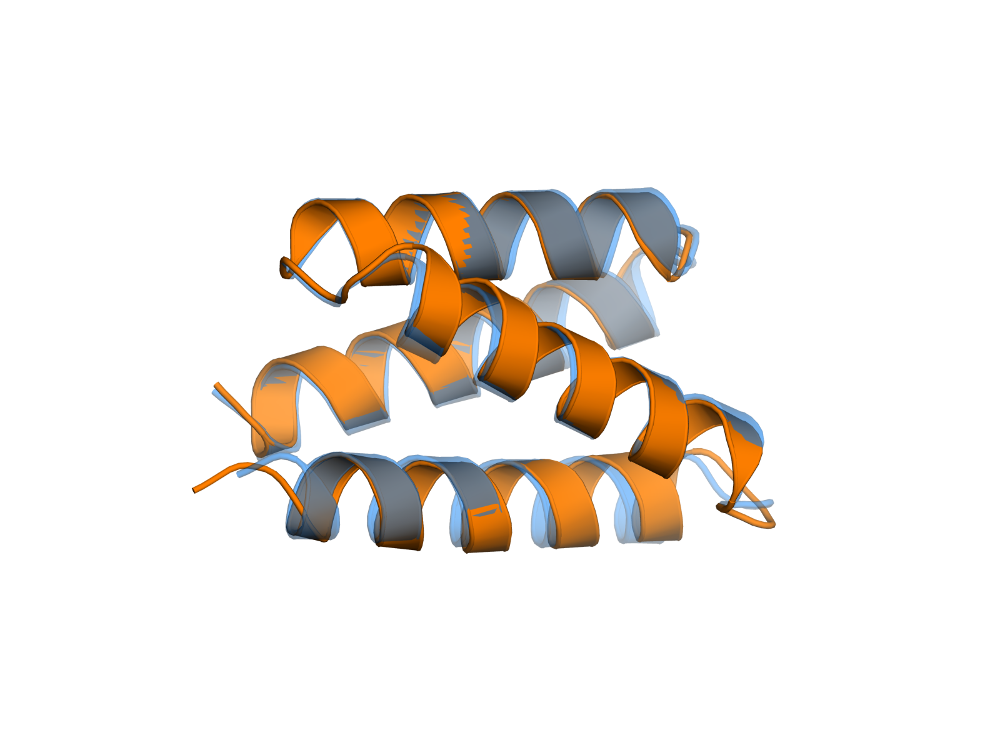
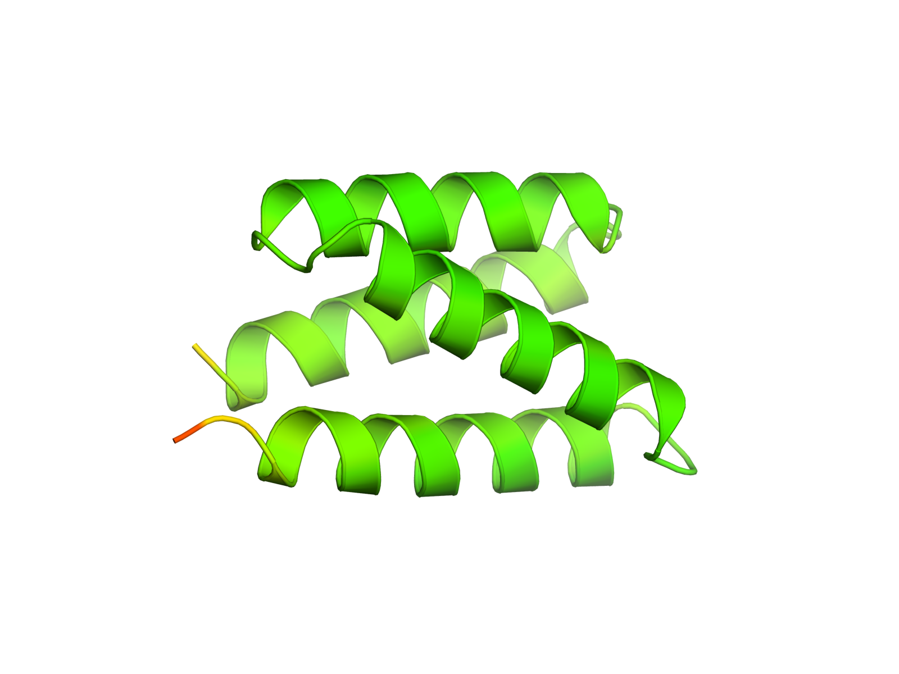
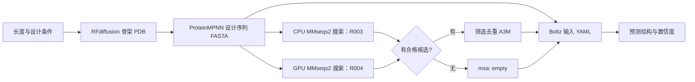

# 蛋白质设计流程跑通记录与使用说明

整理：陈铠洲；更新：2026-10-22。本文用于团队了解已完成工作、检查中间产物和接手运行。代码与附件位于个人开发分支 **[`dev-ckz`](https://github.com/QUHONGYE-gif/ai4s-workspace/tree/dev-ckz)**，尚未经团队会议批准合入 `main`。产物复用的协作讨论另见 [第二份文档](protein_reuse.md)。

开发同步说明（2026-10-25）：本分支已合入 main 的工作台代码及流程脚本重构。下文 R001–R004 是历史运行证据，不代表当前重构版本已完成 GPU 端到端验收；当前脚本保留 CPU/GPU 搜索与来源检查，并补充了命令启动失败记录。新环境优先复制 [通用配置](../configs/protein_design.example.json) 后填写实际路径；[原租用配置](../configs/protein_design.matpool.json) 仅用于核对历史配置。工作台接入状态见 [当前状态](status.md)。

## 阅读入口与现有材料

团队只需阅读两份主文档：**本文完整说明 R001–R004 的实验目的、环境、步骤、参数、结果、失败修正、中间产物与交接状态；[复用讨论稿](protein_reuse.md)说明这些实验对产物复用和加速的启示、工具已有机制及待共同确认的问题。** 下列原始记录与附件链接用于追溯证据，不是理解本文的必读前提。历史运行身份继续保留，后续如需重跑则建立新的记录。

| 材料 | 现有文件与内容 | 何时阅读 |
| --- | --- | --- |
| 实验总览与操作 | 本文第 1–7 节 | 第 1 节看结论，第 2 节看四轮完整过程，第 3–6 节看原理、命令、参数及产物，第 7 节看归档与交接 |
| 复用与加速讨论 | [protein_reuse.md](protein_reuse.md) | 与曲鸿烨讨论可复用对象、失效条件及评测安排 |
| 首次设计证据 | [R001 record.md](../experiments/R001-protein-design-smoke/record.md)、[4 项原始附件索引](../experiments/R001-protein-design-smoke/evidence/index.json)、图表与 PyMOL 脚本 | 查看骨架、序列、预测、叠合及首次部署 |
| CPU MSA 初次验证 | [R002 record.md](../experiments/R002-swissprot-msa/record.md)、[6 项原始附件索引](../experiments/R002-swissprot-msa/evidence/index.json) | 查看库快照、原始搜索条件、设计无命中与天然阳性完整预测 |
| CPU 封装验收 | [R003 record.md](../experiments/R003-pipeline/record.md)、[7 项原始附件索引](../experiments/R003-pipeline/evidence/index.json) | 查看实际封装运行、manifest、检查结果及严格筛选后的阳性解析 |
| GPU 分支补齐 | [R004 record.md](../experiments/R004-mmseqs-gpu/record.md)、[48 项原始附件索引](../experiments/R004-mmseqs-gpu/evidence/index.json)、[完整文件清单](../experiments/R004-mmseqs-gpu/evidence/inventory-final.json)、[回传校验](../experiments/R004-mmseqs-gpu/archive-verification.json) | 查看 padded 库、两种查询、两条 Boltz 预测、CPU/GPU 差异和失败修正 |
| 可复用代码与配置 | [控制脚本](../scripts/protein_design_pipeline.py)、[配置样例](../configs/protein_design.matpool.json)、[边界检查](../tests/test_protein_design_pipeline.py) | 接手运行和修改参数；验收范围见第 1、4 节 |
| 部署与恢复资料 | 本文第 2.1 节与第 7 节 | 查询环境导出、源码修复、备份及未回传材料；不将个人备份位置作为团队入口 |

四份 `evidence/index.json` 共索引 **65 项原始附件**；这个数字不含记录正文、图表及索引自身，也不表示所有中间文件都在 Git。完整产物依靠运行清单与归档追溯，访问方式见第 7 节。README 仍列出 R001–R004 记录作为证据索引，但它们是可选的逐条核查材料；本次实验的面向团队叙述以本文和第二份协作文档为准。

## 1. 本次完成了什么

已在独立租用的 RTX 4090 上部署模型并跑通 **RFdiffusion → ProteinMPNN → 本地 MSA 搜索 → Boltz-2**，保留输入、中间产物、输出与日志，并封装为一条运行命令。验证范围为 **80 残基、无条件、单链、一个骨架、一条设计序列**。

| 任务要求 | 本次完成情况 | 可核查证据 |
| --- | --- | --- |
| 部署模型和虚拟环境、真实生成结构 | 已完成；前两步与 Boltz 分用两个 Conda 环境 | [R001 环境与运行记录](../experiments/R001-protein-design-smoke/record.md) |
| 构建简化 MSA 搜索库 | 已用 Swiss-Prot 建库，天然蛋白阳性对照的 MSA 已接入 Boltz 并完成预测 | [R002 记录及附件](../experiments/R002-swissprot-msa/record.md) |
| 理解参数与中间产物 | 本文第 3、5、6 节；保留扩散轨迹、序列概率、MSA 与预测置信度 | 各运行记录及 `evidence/` |
| 封装 pipeline 并真实验证 | CPU MSA 后端的完整封装已实跑，包含无命中处理和产物检查；新增 GPU 入口状态见下行 | [运行脚本](../scripts/protein_design_pipeline.py)、[配置](../configs/protein_design.matpool.json)、[R003](../experiments/R003-pipeline/record.md) |
| 与曲鸿烨共同梳理复用与加速 | 已形成讨论材料，**待双方讨论确认**；没有测得加速比 | [复用与加速协作讨论稿](protein_reuse.md) |
| 补充 GPU 版 MMseqs2 搜索路径 | GPU 独立分支已完成建库、两种查询、MSA 与 Boltz 预测；新增 pipeline GPU 入口仍待单独验收 | [R004 实验及附件](../experiments/R004-mmseqs-gpu/record.md)；本文第 4.4 节；官方参数说明见 [MMseqs2 GPU 搜索文档](https://github.com/soedinglab/MMseqs2/wiki#gpu-accelerated-search) |

两次新设计序列在本次 Swiss-Prot 库和各自搜索条件下均无命中，因而其 Boltz 预测实际使用 `msa: empty`。天然蛋白对照验证的是“有 MSA 的文件连接和预测路径”。**本次没有验证目标功能、结合能力或实验稳定性，也没有证明 MSA 带来效果提升。**

## 2. R001–R004 完整实验记录

四轮实验均于 **2026-10-21（北京时间）**开展，2026-10-22 补做归档审查。顺序是：R001 手工跑通三个模型 → R002 增加 CPU MSA 搜索及天然阳性预测 → R003 封装完整流程并强化筛选与验收 → R004 从已有序列补齐 GPU 搜索及下游预测。R001 和 R003 分别生成了一条新的设计序列；R002 查询 R001 序列，R004 查询 R003b 序列。天然阳性一直是 P69905。

| 运行 | 输入与目的 | 已验证结果 | 解释边界 |
| --- | --- | --- | --- |
| [R001](../experiments/R001-protein-design-smoke/record.md) | 首次手工执行 80 aa 无条件单链设计 | 骨架、设计序列、Boltz 结构均生成；80 对 Cα 叠合 RMSD **0.827 Å**；`confidence_score` 0.8749 | 未固定 RFdiffusion/Boltz 种子；无 MSA；几何接近不等于功能成立 |
| [R002](../experiments/R002-swissprot-msa/record.md) | R001 设计序列与天然人血红蛋白 α 链 P69905，各自搜索同一库 | 设计 0 命中；天然对照 500 命中，A3M 501 条记录，并完成 Boltz 预测 | 500 为搜索设置上限；没有同一对象有/无 MSA 的效果对照 |
| [R003b](../experiments/R003-pipeline/record.md) | 用封装生成另一条 80 aa 设计，固定各模型种子 | 全流程约 **112.45 秒**；设计 0 命中；结构序列与设计完全一致；`confidence_score` 0.8672 | 已部署环境下的单次墙钟耗时，含预检和模型初始化；不含安装、下载及首次建库；本轮未算 RMSD |
| [R003 阳性补查](../experiments/R003-pipeline/record.md#msa-有命中分支的补充检查) | P69905 使用 R003 更严格的搜索及筛选条件 | 498 候选；去重后 464 条 A3M 记录，含查询；Boltz 解析成功 | 仅 CPU 搜索、筛选与解析，未对这个新 A3M 重跑 GPU 预测 |
| [R004 GPU 分支](../experiments/R004-mmseqs-gpu/record.md) | 复用 R003b 设计序列；P69905 作阳性对照 | 设计 0 命中并完成单序列预测；阳性 498 命中、467 条筛选 A3M，带 MSA 的 Boltz 预测成功 | 从序列处续接；未重跑上游；CPU/GPU 灵敏度与结果不同，不报告正式加速比 |

R003 不是 R001 的重复结构，也没有沿用 R001 的 RMSD。R003 的搜索增加了显式一致性、覆盖度筛选及去重，与 R002 原搜索条件不同。

### 2.1 共用环境、版本与数据身份

实际科学计算在陈铠洲独立租用的矩池云 Linux x86_64 实例进行，R001–R003 原实例为 `wzM56V`，R004 为恢复实例 `wXO8nR`。使用单张 RTX 4090，报告显存 **24,564 MiB**、驱动 **565.77**；R004 glibc 为 2.35。实例盘约 300 GB，平台持久卷 5 GB。历史执行根目录为 `/root/ai4s-trial`，仅用于解释原始清单，不是团队共享目录。团队 Coder 与科研服务器是另外的环境，本次没有在那里完成模型部署或 GPU 验收。

| 组件 | 实验采用的身份／配置 |
| --- | --- |
| RFdiffusion | 官方仓库提交 `86507b6538f51fce57b5a72477165f03999ed7ae`；`Base_ckpt.pt`；Conda `rfd4090` |
| RFdiffusion 依赖 | Python 3.10.22、PyTorch 2.0.1+cu118、DGL 1.0.2+cu118、CUDA Toolkit 11.8；运行时将环境 `lib` 加入 `LD_LIBRARY_PATH`，使用 `DGLBACKEND=pytorch` |
| ProteinMPNN | 官方仓库提交 `8907e6671bfbfc92303b5f79c4b5e6ce47cdef57`；复用 `rfd4090`，模型 `v_48_020` |
| Boltz | 镜像环境 `myconda`；Python 3.11.13、Boltz 2.2.1、PyTorch 2.6.0+cu124；关闭可选 CUDA kernels，`--num_workers 0`；R004 记录 NumPy 1.26.4、Lightning 2.5.0 |
| CPU MMseqs2 | 官方 Linux AVX2 预编译包；版本 `fcf516aba34be4569b3eb5bda2b9db9e26a8f278` |
| GPU MMseqs2 | 官方 Linux GPU 预编译包，版本字符串同上；二进制 SHA-256 `f46fc772abad7417e7ae1bf0f219883fcfc4fa3cdc2ab4117fa6f8bd7e0e9c11`；CPU/GPU 构建分别保管 |
| 可视化 | 独立 `pymol-vis` 环境，开源 PyMOL 3.1.0，用于 R001 叠合及 pLDDT 着色 |

部署时有两类兼容修复：RFdiffusion 首次因 DGL 找不到 CUDA 11 动态库而失败，补装匹配的 CUDA 11.8 运行库并设置动态库路径后成功；安装 Boltz 时 PyTorch 曾被升级到与租用实例驱动不兼容的版本，恢复为 2.6.0+cu124、关闭可选 kernels 后完成预测。因此这是为本次 4090 环境调整过的组合，不能描述为原封不动复现 RFdiffusion 官方旧版环境，也未验证 Boltz 可选 kernels。

**数据库快照。** 2026-10-21 16:48 从 UniProt 官方 `uniprot_sprot.fasta.gz` 下载 Swiss-Prot，搜索日志报告 **575,748 条序列**；压缩 **93,801,562 字节（约 89.4 MiB）**，解压 **288,201,213 字节（约 275 MiB）**。这是源 FASTA 大小，不是建库后全部文件或模型环境大小。

```text
Swiss-Prot 压缩 FASTA SHA-256
a9c3496aa727e61d25d9e1291c9ba28d2c2ad19c0e26569dc083d53ec4169536
Swiss-Prot 解压 FASTA SHA-256
1372f18e218d761027616bf17479bcf450b30314fc0a8095fcb0e97e85d6ecf9
GPU MMseqs2 原始发布包 SHA-256
4e3ce8a250b42ff35d51ce94e79fdfd29c36d6af8ec28c6514f20281eef80a57
R003 检查的 RFdiffusion Base_ckpt.pt SHA-256
0fcf7d7c32b4848030aca3a051e6768de194616f96ba6c38186351a33bfc6eca
R003 检查的 ProteinMPNN v_48_020.pt SHA-256
c9cb4a671d79604111231f8dbfc7c590e06f1197453b7a6854ac6661a642f5bd
R003 检查的 Boltz boltz2_conf.ckpt SHA-256
090e82ac8c92f5e943fa1b39e7410a44027bea7243c0bbb3caa67a77fc1428e1
```

数据库 `current_release` 与软件 `latest` 地址会更新，复现应匹配上述快照及工具身份。R004 沿用恢复环境，未在当晚重新计算 Boltz 权重哈希；不能把历史权重记录说成当晚再次核实。完整环境导出、权重检查及兼容修复日志的保管方式见本文第 7 节。

### 2.2 R001：手工跑通骨架、序列与预测

**目的与输入。** 不指定靶标、motif、结合位点、模板或功能，只指定 80 aa 单链，生成一个骨架、一条序列、一个预测结构。该轮先省去 MSA，以便验证三个模型之间的数据连接。

**实际执行过程。**

1. RFdiffusion 设置 `contigmap.contigs=[80-80]`、`inference.num_designs=1`。第一次因上述 DGL/CUDA 动态库问题启动失败；修复后的第二次退出 0，生成 `results/rfd/mono80_0.pdb`、同名 `.trb` 及 `results/rfd/traj/` 中两条轨迹 PDB。骨架中的 GLY 是占位残基。
2. ProteinMPNN 读取该骨架，`--num_seq_per_target 1 --sampling_temp 0.1 --seed 42 --save_score 1 --save_probs 1`。生成 `results/mpnn/seqs/mono80_0.fa`、`probs/mono80_0.npz`、`scores/mono80_0.npz`。FASTA 第一条是全 GLY 原骨架记录，第二条才是采样序列；本轮把第二条交给下游，采样得分 **1.1668**。
3. 将设计序列写入 `inputs/mono80.yaml`，显式 `msa: empty`。Boltz 输出采用 PDB、`--no_kernels --num_workers 0`，成功日志显示 `Number of failed examples: 0`。输出位于 `results/boltz/boltz_results_mono80/`，含 `processed/`、预测 PDB、置信度 JSON 及 pLDDT/PAE/PDE NPZ。
4. 在独立 PyMOL 环境中按残基顺序对 80 对 Cα 刚体叠合，同时核对 PDB B-factor 与 80 位 pLDDT NPZ 值，绘制叠合和置信度图。

**结果。** 骨架与预测均为 80 残基、80 个 Cα；叠合 RMSD **0.827 Å**。Boltz `confidence_score=0.8749`、`ptm=0.8113`、`complex_plddt=0.8908`。MPNN 得分与 Boltz 置信度的定义不同，不直接比较。

**复现及解释边界。** RFdiffusion 与 Boltz 本轮未固定种子，重跑不保证相同结构。RMSD 只支持本例骨架与预测几何接近，不证明真实折叠、稳定性或功能。该轮没有 MSA；Boltz 日志提示单序列预测可能欠佳，不能改写成已获得同源信息。首次失败日志 `logs/rfd-run.log`、修复成功日志 `logs/rfd-run-02.log`、MPNN/Boltz 日志和概率、轨迹均保留在归档。

### 2.3 R002：增加 CPU MSA 搜索与天然阳性预测

**目的与输入。** 采用相对小的 Swiss-Prot 库验证本地搜索、A3M 生成、Boltz 接入。两条查询分别是 R001 设计序列（80 aa）与天然人血红蛋白 α 链 **P69905（142 aa）**；后者从该 Swiss-Prot 快照提取，是流程阳性对照。

**实际执行过程。** 解压源 FASTA → `createdb` 建目标库和双查询库 → CPU `search` → `convertalis` 导出 TSV → `result2msa --msa-format-mode 5` → `unpackdb` 导出 A3M → 将天然对照 A3M 写入 Boltz 输入并完整预测。CPU 搜索参数为 `-s 7.0 -e 0.001 --max-seqs 500 --threads 10`；本轮**没有显式设置 0.3 一致性或 0.8 查询覆盖阈值，也未启用显式精确一致性计算**，导出的 `fident` 为估计值。

| 查询 | 搜索与 A3M | 下游验证 |
| --- | --- | --- |
| R001 设计 | 0 命中；`results/msa/0.a3m` 仅 1 条查询，80 对齐列 | 没有为这条设计得到真实多序列信息，R001 的预测仍属单序列模式 |
| P69905 | 达到 500 命中上限；`results/msa/1.a3m` 为 501 条记录（含查询）、142 对齐列，约 75 KiB | `inputs/hba_with_msa.yaml` 引用此 A3M，Boltz 完整预测成功、失败数 0；输出为 CIF、置信度与 NPZ，并保留 processed 数据 |

天然对照置信度为 `confidence_score=0.930688`、`ptm=0.913338`、`complex_plddt=0.935025`。这支持“本次搜索生成的 A3M 能接入 Boltz 并产生预测”，不支持“MSA 提升了预测效果”，因为没有给同一对象设置有/无 MSA 对照；天然蛋白也不是设计蛋白的功能对照。

**产物与负面结果。** 保留双查询 FASTA、命中 TSV（字段为 `query,target,fident,alnlen,qcov,tcov,evalue,bits`）、两份 A3M、Boltz YAML/输出/日志、压缩源 FASTA 与 CPU 工具包。原 R002 归档不含全部可重建搜索库及临时文件，后续另存 CPU DB/tmp 补充包。设计无命中的准确含义是“在此库和本次参数下未发现命中”；它不是“数据库搜索失败”，也不能推出所有数据库都无同源。新设计可能缺少天然近邻、更远同源可能未检出，具体原因本次没有进一步验证。

### 2.4 R003：完整 CPU 搜索 pipeline 封装与严格筛选

**目的。** 将骨架生成 → 序列设计 → CPU 本地搜索 → 筛选 → Boltz 连接为单命令，保存实际参数、源码/权重/环境身份、日志、状态和文件哈希，并在成功前检查真实产物。这里的“CPU”只描述搜索，两个结构模型仍使用 GPU。

**实际输入与设置。** 从头生成新的 80 aa 骨架，不沿用 R001：RFdiffusion `deterministic=True`、`design_startnum=42`（官方脚本以编号 42 作种子）、扩散 50 步；MPNN `v_48_020`、seed 42、temperature 0.1、1 条序列；Boltz `boltz2`、seed 42、recycling 3、sampling 200、1 个结构、关闭 kernels。注册并复用 R002 已建目标库，未重新下载或预建大型 `createindex`。

CPU 搜索保留 `-s 7 -e 0.001 --max-seqs 500 --threads 10`，新增 `-a 1 --alignment-mode 3 --min-seq-id 0.3 -c 0.8 --cov-mode 2`：保留比对回溯，显式计算一致性，要求一致性 ≥0.3、查询覆盖 ≥0.8；随后按阈值筛选、剔除查询重复项并去重。不能把这个配置与 R002 当作完全一致。

**失败与修正。** 首轮 `R003-pipeline` 在预检发现 RFdiffusion 源码目录有未跟踪 `outputs/` 而停止；检查证实为 Hydra 自动生成目录，没有受版本管理的源码修改。修正为仅允许这一生成目录，同时保存 Git 状态和 patch，其他源码变化仍会拦截。首次失败目录保留；成功使用新的 `R003b-pipeline`，tmux 会话 `ai4s-R003b`，运行完成后自动结束。

**成功运行。** 北京时间 **18:09:36–18:11:29**，约 **112.45 秒**，包含预检、Conda 与模型初始化，不含安装、下载及首次建库。

| 阶段 | 子命令墙钟 | 关键产物／观察 |
| --- | ---: | --- |
| RFdiffusion | 38.255 秒 | 80 aa 骨架、`.trb`、两类轨迹；日志显示 `Using cached IGSO3.` |
| ProteinMPNN | 3.472 秒 | 80 aa 设计 FASTA、概率和评分 NPZ |
| CPU MMseqs2 search | 11.035 秒 | 设计 0 命中；空命中表及仅查询 A3M 保留 |
| Boltz | 46.721 秒 | `msa: empty`，1 个预测 PDB、置信度与 NPZ；各项检查通过 |

R003b 的设计序列如下，R004 使用同一条序列：

```text
SLLKLLLEEKLKEEKLIEEAKKRIKELLETTKDKEELIEKLEEIAEELEKEPVLEELKELVEERIEDLKAGKEKEYEIKL
```

`msa/summary.json` 为 `used_by_boltz=false`。预测单链序列与设计完全一致，`confidence_score=0.8671682477`、`ptm=0.7490227222`、`complex_plddt=0.8967046738`；结构数量、残基数量、有限置信度、NPZ ZIP 完整性通过。**本轮未算 RMSD，不能借用 R001 的 0.827 Å。** 回传时核对成功 manifest 中 67 个普通文件的大小与 SHA-256，全部匹配。历史执行脚本 SHA-256 为 `f59cbe99eb26ba64716a7089d3b6081c9b9fcef050cb8c57f38047edb3e58cc7`；后续 GPU 扩展后的当前脚本不能继续声称与这个旧快照逐字节相同。

**天然阳性补查。** 对同一 P69905 用新 CPU 搜索参数及筛选逻辑，得到 **498 候选 → 499 条原始 A3M（含查询）→ 464 条筛选 A3M（463 条非查询）**，均为 142 对齐列。调用 Boltz 2.2.1 的 `parse_a3m` 并写出 MSA NPZ 成功，**没有对这份 464 条 A3M 重新执行完整结构预测**。首个辅助命令将小数写成 `.3/.8`，MMseqs2 报 `Error in argument --min-seq-id`；改成 `0.3/0.8` 后在新目录成功，失败目录 `R003-positive-msa` 保留。主封装本来使用 `0.3`，不受该辅助命令错误影响。

**代码验证范围。** 当时 5 项确定性检查覆盖采样序列选择、A3M 插入列、同时筛选与去重、已有运行目录保护、缺预测不能标记完成。它们与此次真实模型实跑共同支持该 CPU 后端封装的数据连接正确；不证明功能或科学效果。

### 2.5 R004：GPU 搜索、完整下游与 CPU 差异

**目的与输入。** 在恢复实例补齐 GPU 版 MMseqs2。复用 R003b 设计 FASTA（80 aa）与 P69905（142 aa），不重跑 RFdiffusion/MPNN。设计 FASTA SHA-256 为 `b8d3aa156dab83dd6a7bd36c35cf18ab560a04046d37c6145ed6fcc6df75caeb`，天然查询为 `9f28ee2461cfee4c04e56bb447316d0ad23687d15f3da13aaae5946de4f0273a`。成功运行身份为 `R004-mmseqs-gpu/audited-b`，使用独立审计脚本及既有筛选辅助函数。

**实际执行过程。**

1. 从同一解压 Swiss-Prot FASTA 用 GPU 发布包执行 `createdb`，耗时约 **1.652 秒**；再执行 `makepaddedseqdb` 得 GPU padded 目标库，约 **5.345 秒**。这是准备步骤，单独记录，不称为 GPU 搜索。
2. 对设计、天然查询分别执行查询 `createdb` → `search --gpu 1` → `convertalis` → `result2msa --msa-format-mode 5` → `unpackdb` → 筛选去重。环境 `CUDA_VISIBLE_DEVICES=0`，搜索带 `-e 0.001 --max-seqs 500 --threads 10 -a 1 --alignment-mode 3 --min-seq-id 0.3 -c 0.8 --cov-mode 2`。GPU 采用最高灵敏度，**不传 CPU 的 `-s 7`**。日志记录 `Use GPU 1` 和 `ungappedprefilter ... --gpu 1`；不把 TSV/A3M 导出与筛选统称为 GPU 计算。
3. 设计 0 命中，Boltz YAML 用 `msa: empty`；天然阳性将筛选后 A3M 写入 YAML。两者均使用 `boltz2`、GPU 0、seed 42、recycling 3、sampling 200、diffusion samples 1、PDB 输出、`--no_kernels --num_workers 0`，完整预测并检查。

成功审计运行于北京时间 **22:50:04–22:51:18**，约 **73.50 秒**，包含两种查询及其下游，建库另计。tmux 会话 `ai4s-R004b` 随完成退出，总日志 `logs/audited-b-driver.log`。不能与只含一条设计的 R003 总时长直接作加速对照。

| 分支 | GPU search 墙钟 | Boltz 墙钟 | confidence_score | pTM | complex_plddt |
| --- | ---: | ---: | ---: | ---: | ---: |
| 80 aa 设计 | 0.510 秒 | 36.303 秒 | 0.867168 | 0.749023 | 0.896705 |
| P69905 阳性 | 0.470 秒 | 34.501 秒 | 0.922421 | 0.899979 | 0.928032 |

设计分支仅查询 A3M；阳性为 **498 候选 → 499 条原始 A3M → 467 条筛选 A3M（466 条非查询）**。两条预测各 1 份 PDB，长度为 80/142，单链序列与查询完全一致，主要置信度均有限；设计 5 个、阳性 6 个 NPZ 的 ZIP 完整性通过；阳性有 processed MSA，确实完成带 MSA 的预测。

**与 CPU 的实际差异。** R003 阳性和 R004 阳性都为 498 候选，但目标共有 **487 个**、各 **11 个独有**；最终 A3M 为 **464 对 467 条**，内容不同。

```text
仅 CPU 目标：P02053 P02081 P24292 P68065 P68194 P68232
             P68234 P68256 P68257 P68258 Q28221
仅 GPU 目标：P02020 P02042 P02050 P02089 P02093 P02102
             P06642 P67823 P67824 P86391 Q7M2Y5
CPU 筛选 A3M SHA-256：cea3f0e6059f98662c25ce1a06adc5c2512e912ffe0fba056c009ed02ac2807d
GPU 筛选 A3M SHA-256：ae724d3749f39d2dfbfc612330d8c8bb059d894d8818d78f1ead425e467b4d59
```

后端、灵敏度和候选集合都有变化，不能把差异仅归因于硬件，也不能认为记录更多就更好。本次仅单次墙钟，无冷热缓存控制、重复运行或显存峰值采样；**没有正式加速比或有/无 MSA 的效果结论**。

**失败与修正全部纳入交接。**

| 事件 | 实际发生与保留状态 |
| --- | --- |
| 首次建库包装失败 | 依赖不存在的 `/usr/bin/time`，转换未启动；改用 Python 计时成功。早期同名日志被成功日志覆盖，只保留当时终端观察的错误说明，不能声称失败日志原件完整 |
| 交互搜索误重复执行 | JupyterLab 回显延迟，首次退出 0 后误重复提交，重复命令退出 1 并覆盖首份日志；首次结果/临时目录保留，新前缀 `gpu_hits_retry1` 成功且保留日志，不推导已覆盖首轮耗时 |
| `audited/` 验收失败 | GPU 搜索与 Boltz 已退出 0，但验收查找 `boltz/predictions/`，遗漏 `boltz_results_input/`；属输出定位错误，原目录与失败 manifest 保留 |
| `audited-b/` 成功 | 修正路径、换新目录，重新执行两种查询及预测并通过检查，未覆盖失败记录 |
| GPU 封装本地修正 | 修正 staging 检查误拦截 CPU 建库，将 GPU staging 冲突检查前移至解压前；扩展后 9 项确定性检查通过 |

**实现验收边界。** R004 验证的是独立审计脚本运行。仓库新增统一 GPU `build-db/run` 入口有命令构造和建库边界测试，**尚未远程端到端验收**；不能将本轮审计成功或本地 9 项测试替代这一验收。

### 2.6 可视化与本轮实验结论



图中蓝色半透明为 R001 的 RFdiffusion 骨架，橙色为 Boltz 预测结构。



第二幅图按 PDB B-factor 的 pLDDT 着色，范围 50–100，红色较低、黄色居中、绿色较高，数值与 NPZ 对应。图片来自首次成功可视化；共享版脚本只调整输入/输出位置，整理文档时未重新渲染。从仓库根目录运行以下命令可生成图片和可交互会话至 `runs/R001-visualization/`：

```bash
pymol -cq experiments/R001-protein-design-smoke/visualize.pml
```

**本轮支持的结论：** 三模型数据链路、CPU 搜索封装、GPU 搜索分支、天然阳性 A3M 接入 Boltz、文件与序列一致性检查均有真实执行证据；设计序列在本次库和条件下无命中。**仍未验证：** 功能、结合、湿实验稳定性、MSA 带来的效果提升、正式加速收益、GPU 统一入口端到端运行及更大/复杂对象的资源需求。

## 3. 每一步在做什么



两条分支从**同一条 R003b 设计序列**开始比较搜索路径。R004 复用了上游 FASTA，没有重新生成骨架和序列；它先从同一 Swiss-Prot FASTA 建独立普通库与 padded 库。这里“CPU/GPU 分支”指 MMseqs2 搜索后端，**CPU 分支中的 RFdiffusion 和 Boltz 仍使用 GPU**。实际运行不是整条流程只用 CPU。

另以天然蛋白 P69905 验证有命中的路径，它不是 ProteinMPNN 的设计结果。R002 对原始 CPU A3M 完成预测；R003 严格筛选后的 CPU A3M 仅验证解析；R004 的 GPU A3M 完成预测。三者不能当作同一条件的重复实验。

**RFdiffusion：生成主链空间形状。** 本例只指定长度，不指定功能或结合靶标。骨架 PDB 中的甘氨酸是占位残基，不能当成最终设计序列。`.trb` 保存实际配置和映射等元数据，轨迹 PDB 保存逐步扩散坐标，用于理解中间过程。

**ProteinMPNN：为骨架选择氨基酸序列。** 输入是骨架坐标，输出是采样序列及评分/概率。FASTA 第一条是原骨架记录，第二条才是本次采样序列；脚本检查 `sample=1`、长度和残基字符，避免把全甘氨酸送给下游。它不证明序列一定按骨架折叠。

**MSA：多序列比对（Multiple Sequence Alignment）。** Swiss-Prot 是序列数据库，MMseqs2 是搜索和比对工具，A3M 是比对结果文件。这里先搜索相似序列，再按一致性、查询覆盖度和 E 值筛选、去重。MSA 可提供多条相关序列的进化信息；达到计算阈值仍需检查生物学合理性。新设计可能没有天然同源物，只有查询自身的一行 A3M 不等于找到了同源 MSA。

**Boltz-2：由序列及可选 MSA 预测结构。** 本例没有配体或功能约束，使用结构预测模式。保存预测坐标、整体置信度和 pLDDT/PAE/PDE 等输出；可与原骨架叠合做一致性检查。置信度是模型估计，不是实验结论。

## 4. 团队如何使用代码

### 4.1 仓库内容与前提

| 仓库路径 | 用途 |
| --- | --- |
| [scripts/protein_design_pipeline.py](../scripts/protein_design_pipeline.py) | 标准库控制脚本，调用已经部署的官方模型和 MMseqs2；提供 `run`、`build-db`、`register-db` |
| [configs/protein_design.matpool.json](../configs/protein_design.matpool.json) | R003 实际配置；固定源码和主要包版本，**其中路径是原租用环境路径，换环境必须调整** |
| [tests/test_protein_design_pipeline.py](../tests/test_protein_design_pipeline.py) | 无需 GPU 的数据连接边界检查 |
| [experiments/](../experiments/) | R001–R004 详细记录、小型原始附件和图表；逐项入口见文首 |

脚本没有重写模型，也不是一键安装器。真实执行要求 Linux x86_64、已授权的 GPU、足够的数据盘空间、已安装的模型源码/依赖/权重、Boltz 数据资料和 MMseqs2。实际版本、环境分工与兼容修复已写在本文第 2.1 节，恢复材料见第 7 节；[环境说明](environment.md)维护当前通用依赖，历史部署身份见本文第 2.1 节。本次只证明该小案例能在单张 24 GB 4090 上运行，未测显存峰值，不将 24 GB 写成所有任务的最低要求。团队 Coder 尚不能视为已部署好的 GPU 环境。

准备好的数据根目录应有以下真实内容，其中 `src/` 为固定版本的官方仓库，不能用未审查的新版本替代：

```text
<AI4S_ROOT>/
├── src/RFdiffusion/             # 含 models/Base_ckpt.pt 及 SE3 依赖
├── src/ProteinMPNN/             # 含 vanilla_model_weights/v_48_020.pt
├── tools/mmseqs/bin/mmseqs
├── db/uniprot_sprot.fasta.gz
└── cache/boltz/                 # 模型权重与所需分子资料
```

### 4.2 调整路径并查看执行计划

先取得 `dev-ckz` 分支。以下命令均从**仓库根目录**执行；在终端先将 `AI4S_ROOT` 设为执行环境已分配的数据目录，将 `AI4S_CONDA_ROOT` 设为该环境的 Conda 安装目录。二者必须是实际绝对路径；JSON 不会自动展开环境变量。

```bash
python - "$AI4S_ROOT" "$AI4S_CONDA_ROOT" <<'PY'
import json, sys
from pathlib import Path
root, conda_root = map(Path, sys.argv[1:])
assert root.is_absolute() and conda_root.is_absolute(), "请先设置实际绝对路径"
assert root.is_dir() and conda_root.is_dir(), "目录尚未准备好"
c = json.loads(Path("configs/protein_design.matpool.json").read_text())
c.update(root=str(root), conda=str(conda_root / "bin/conda"),
         rfd_env=str(conda_root / "envs/rfd4090"),
         boltz_env=str(conda_root / "envs/myconda"))
c["msa"]["database"] = str(root / "db/swissprot")
(root / "pipeline-config.json").write_text(json.dumps(c, indent=2) + "\n")
PY

python scripts/protein_design_pipeline.py run \
  --config "$AI4S_ROOT/pipeline-config.json" \
  --out "$AI4S_ROOT/runs/team-design-001" --dry-run
```

若 Conda 环境名称或 GPU 编号不同，还需修改生成的配置。`--dry-run` 仅检查配置并显示计划，不检查模型安装、GPU 或数据库，也不创建运行目录。

### 4.3 准备数据库并正式执行

新环境先取得已核验的 Swiss-Prot 压缩 FASTA，大小及 SHA-256 见本文第 2.1 节。源为 [UniProt 官方 FASTA](https://ftp.uniprot.org/pub/databases/uniprot/current_release/knowledgebase/complete/uniprot_sprot.fasta.gz)，`current_release` 会更新；要复用本轮身份，必须匹配本次源文件 SHA-256，不能仅凭下载地址相同。

```bash
python scripts/protein_design_pipeline.py build-db \
  --config "$AI4S_ROOT/pipeline-config.json" \
  --fasta-gz "$AI4S_ROOT/db/uniprot_sprot.fasta.gz"
```

这会解压 FASTA、调用 `createdb`，保存源文件、工具及库文件的哈希；使用 CPU，不是建完整 `createindex` 索引。数据库前缀必须尚不存在。若使用来源明确、已经建好的 R002 库，可用 `register-db` 替代 `build-db`；它只登记来源，不能证明任意未知库与所给 FASTA 对应。

正式执行前检查 GPU、磁盘和已有任务；按执行环境的资源规则使用单卡。长任务先进入具名 tmux 会话，再在仓库根目录执行：

```bash
python scripts/protein_design_pipeline.py run \
  --config "$AI4S_ROOT/pipeline-config.json" \
  --out "$AI4S_ROOT/runs/team-design-001"
```

**每次必须使用新 `--out`。** 当前脚本不覆盖、不自动续算，也没有跨运行的科学结果缓存。源码版本或安装状态不符会停止；失败目录、清单及日志保留。调整参数后保存新配置、新运行编号，不能覆盖已完成证据。

无需模型环境即可执行代码边界检查：

```bash
python -m unittest discover -s tests -p 'test_protein_design_pipeline.py' -v
```

### 4.4 使用 GPU 版 MMseqs2 搜索

这条路径替换的是 MSA 搜索步骤，前后 RFdiffusion、ProteinMPNN 和 Boltz 不变。MMseqs2 官方 GPU 构建支持蛋白质序列搜索；GPU搜索需要独立的 GPU 二进制和经 `makepaddedseqdb` 转换的目标库。GPU 搜索本身通过 `--gpu 1` 开启，后续 `convertalis`、`result2msa`、`unpackdb` 仍由 MMseqs2 执行，当前记录不把这些导出步骤描述为 GPU 加速。

**官方要求**：预编译 GPU 包要求 Linux glibc ≥ 2.29、NVIDIA Driver ≥ 525.60.13；无需单独安装 CUDA Toolkit。GPU搜索支持 Turing，但官方称 Ampere 或更新架构可达到完整速度。GPU 后端固定在最高灵敏度，CPU 路径的 `-s 7` 不用于 GPU 搜索；其余 E 值、候选数和覆盖度筛选仍按配置工作。见 [官方安装与 GPU 搜索说明](https://github.com/soedinglab/MMseqs2/wiki)。

以下操作在**实际 GPU Linux 执行环境**进行。先检查资源并确认获准使用的 GPU：

```bash
nvidia-smi
ldd --version | head -n 1
```

获取官方 GPU 预编译包后，解压到数据根目录的独立位置（不要覆盖 CPU 版）：

```bash
mkdir -p "$AI4S_ROOT/tools/mmseqs-gpu"
# 将官方 mmseqs-linux-gpu.tar.gz 放在当前目录后：
tar -xzf mmseqs-linux-gpu.tar.gz -C "$AI4S_ROOT/tools/mmseqs-gpu" --strip-components=1
"$AI4S_ROOT/tools/mmseqs-gpu/bin/mmseqs" version
```

先复制实际配置并改 GPU 后端、数据库前缀和 GPU 二进制版本。`version` 输出必须逐字填入配置；保留独立副本，CPU 配置和已有数据库不动：

```bash
python - "$AI4S_ROOT/pipeline-config.json" "$AI4S_ROOT/pipeline-config-gpu.json" \
  "$AI4S_ROOT/tools/mmseqs-gpu/bin/mmseqs" <<'PY'
import json, subprocess, sys
from pathlib import Path
source, target, binary = map(Path, sys.argv[1:])
c = json.loads(source.read_text())
c["msa"]["backend"] = "gpu"
c["msa"]["database"] = str(Path(c["root"]) / "db/swissprot-gpu")
c["msa"]["mmseqs_version"] = subprocess.check_output([str(binary), "version"], text=True).strip()
target.write_text(json.dumps(c, indent=2) + "\n")
PY
```

在 GPU 配置下调用既有 `build-db`，从同一份 Swiss-Prot FASTA 生成普通 MMseqs2 数据库，再生成 GPU padded 数据库。构建耗时和存储由数据库大小决定；构建结果与 FASTA 哈希、二进制版本及 SHA-256、建库命令一并写入 `.source.json`。该步骤不会改写 FASTA、CPU 库或已有运行：

```bash
python scripts/protein_design_pipeline.py build-db \
  --config "$AI4S_ROOT/pipeline-config-gpu.json" \
  --fasta-gz "$AI4S_ROOT/db/uniprot_sprot.fasta.gz"
```

建库后核查 provenance、设备可见性及 dry-run，再用**新运行目录**启动完整 pipeline：

```bash
cat "$AI4S_ROOT/db/swissprot-gpu.source.json"
python scripts/protein_design_pipeline.py run \
  --config "$AI4S_ROOT/pipeline-config-gpu.json" \
  --out "$AI4S_ROOT/runs/team-design-gpu-001" --dry-run
python scripts/protein_design_pipeline.py run \
  --config "$AI4S_ROOT/pipeline-config-gpu.json" \
  --out "$AI4S_ROOT/runs/team-design-gpu-001"
```

GPU `run` 会在 manifest 中保存实际调用参数，搜索命令带 `--gpu 1` 且不传 CPU 灵敏度参数；也会校验运行二进制与 padded 库哈希。数据库需要通过此配置的 `build-db` 生成；`register-db` 不接受 GPU 库，以免把来源不明的 padded 文件登记成已验证来源。单次 Swiss-Prot 查询不要求常驻 `gpuserver` 或预建 `createindex`。

**验证状态与比较办法**：[R004](../experiments/R004-mmseqs-gpu/record.md) 已用独立审计脚本完成真实 GPU 搜索和两条下游 Boltz 分支，保留每步耗时、参数、文件清单与失败记录。上述新增 GPU `build-db/run` 封装入口通过本地命令构造与建库边界测试，未直接完成端到端验收；不要混淆两者。显存峰值、正式性能对照仍未测量。要比较 CPU 与 GPU，使用相同查询序列、同一 FASTA/数据库快照及相同筛选阈值，分别保存运行记录；检查命中数、候选标识、最终 A3M 和 Boltz 输入。CPU 与 GPU 的搜索/排序结果不可预先假定完全相同，性能提升也须实测后再报告。

## 5. 哪些参数要固定，哪些可以改

以下是 R003 的演示配置，不是各类蛋白设计的最优设置。对照时，应固定未研究的因素并记录改变项。

| 阶段／参数 | 当前值 | 修改的含义 |
| --- | --- | --- |
| 源码、依赖、权重、库快照 | 固定版本，保存哈希与环境清单 | 决定计算身份；升级后需重新验证 |
| `length` | 80 | 骨架和序列长度；增大会改变对象、计算与显存需求 |
| `rfd_seed` | 42 | 设置 `deterministic=True`、`design_startnum=42`；官方脚本以设计编号为种子 |
| `rfd_steps` | 50 | 扩散步数；减少可能改变质量，不能直接称无损加速 |
| RFdiffusion 轨迹 | 开启 | 保留 `Xt-1`、`pX0` 轨迹；增加存储 |
| `mpnn_model` | `v_48_020` | 骨架条件序列模型；换权重会改变设计条件 |
| `mpnn_seed`／`mpnn_temperature` | 42／0.1 | 控制随机采样及多样性；MPNN 的 seed=0 表示另选随机种子 |
| MPNN 数量／batch／backbone noise | 1／1／0 | 当前仅验证一条序列；多候选选择尚未封装 |
| `msa.mode` | `swissprot` | 先搜索，无合格候选则 `empty`；显式设 `empty` 可跳过搜索 |
| CPU 灵敏度／E 值 | 7.0／0.001 | GPU 不传 `-s 7`，采用最高灵敏度；E 值不是同源概率 |
| 查询覆盖／最低一致性 | 0.8／0.3 | `--cov-mode 2`；限制局部短片段与低一致性命中，不是同源关系的通用判据 |
| 搜索回溯／一致性计算 | `-a 1 --alignment-mode 3` | 保留比对及显式一致性；R002 原 TSV 的 `fident` 是估计值 |
| 候选上限／CPU 线程 | 500／10 | 限制候选和并行度；达到上限不等于库中只有这些命中 |
| `boltz_seed` | 42 | 固定采样随机性；跨硬件、依赖仍不保证逐位相同 |
| Boltz model／recycling | boltz2／3 | 模型与循环精炼次数 |
| sampling steps／samples | 200／1 | 去噪步数与结构数量；调整是质量、数量与成本的取舍 |
| Boltz kernels／workers | 关闭／0 | 沿用已验证兼容路径；可选 kernels 未验证 |

筛选后的 A3M 必须首行等于当前查询、所有行对齐列数一致。小写插入不计入对齐列；当前按去掉插入与缺口后的比对主序列去重。计算筛选通过与可信生物学同源需要分别判断。

## 6. 中间产物、目录与检查

### 6.1 R003 统一封装的产物

以下路径相对统一封装的 `--out`，已由 R003 CPU 搜索路径验证。R001/R002 手工运行及 R004 独立审计脚本布局不同，分别在后两节列出。表中通配符表示一组实际配套文件，不表示它们已全部附在 Git。

| 相对路径 | 内容与用途 |
| --- | --- |
| `config.json`、`pipeline.py` | 配置与执行脚本快照 |
| `manifest.json`、`logs/` | 状态、时间、实际 argv/cwd、退出码、耗时、环境/源码检查、权重及文件哈希、子命令日志 |
| `rfd/design_42.pdb`、`.trb`、`backbone.pdb` | 骨架、元数据、骨架便捷副本；编号随种子改变；`.trb` 为 pickle，仅读取可信来源 |
| `rfd/traj/` | 两类多状态扩散轨迹，可用 PyMOL 查看 |
| `mpnn/seqs/*.fa` | 原骨架记录、采样序列及评分 |
| `mpnn/probs/*.npz`、`mpnn/scores/*.npz` | 概率、log 概率、采样与评分；不是可任意重采样的完整模型状态 |
| `inputs/design.fasta` | 实际用于搜索和结构预测的设计序列 |
| `msa/database.source.json` | 本次使用的数据库来源快照 |
| `msa/hits.tsv`、`msa/a3m/0.a3m` | 原始命中表与比对，0 命中也保留 |
| `msa/design.filtered.a3m`、`msa/summary.json` | 筛选去重结果、数量、是否交给 Boltz 及原因 |
| `msa/query*`、`hits*`、`alignment*`、`tmp/` | 查询库、结果库、比对库、搜索临时文件 |
| `inputs/design.yaml` | Boltz 输入，使用有效 YAML 的 JSON 语法；指定当前序列及 A3M 或 `empty` |
| `boltz/boltz_results_design/processed/` | Boltz 预处理数据，与版本和输入有关 |
| `boltz/boltz_results_design/predictions/design/` | 预测 PDB、整体置信度 JSON、逐位 pLDDT、成对 PAE/PDE NPZ |
| `checks.json` | 残基数、结构数量、预测序列一致性、置信度、MSA 状态 |

脚本要求预测结构存在、序列匹配、样本数量符合配置、置信度有限、NPZ ZIP 完整，才标记 `completed`。这些是文件与连接检查，不等于科学质量合格；部分上游会捕获异常并跳过输入，因此仅检查退出码 0 不够。

R003 `rfd/traj/` 的两个实际文件是 `design_42_Xt-1_traj.pdb` 和 `design_42_pX0_traj.pdb`；MPNN 对应 `seqs/design_42.fa`、`probs/design_42.npz`、`scores/design_42.npz`。Boltz `processed/` 包括 `structures/design.npz`、`mols/design.pkl`、`records/design.json`、`constraints/design.npz`，预测目录有 `design_model_0.pdb`、`confidence_design_model_0.json`、`plddt_design_model_0.npz`、`pae_design_model_0.npz`、`pde_design_model_0.npz`，另有 Lightning `hparams.yaml`。设计无 MSA，不应要求它一定产生多序列 processed MSA。

查询库 `query` 及配套 `.dbtype/.index/.lookup/.source`、`query_h` 及 `.dbtype/.index` 保存查询序列和头信息；`hits`、`alignment` 分别保留搜索和比对内部结果及 `.dbtype/.index`。`msa/tmp/<运行哈希>/` 有 `blastp.sh`、`pref_0` 及类型/索引文件，`tmp/latest` 指向本轮临时目录。它们与最终 TSV/A3M 不同，不因设计 0 命中就删除。环境、GPU、源码 Git 状态/patch、freeze、版本和各子命令日志均在 `logs/`；manifest 记录实际 argv/cwd、状态、时间、耗时与哈希。

### 6.2 R001/R002 手工运行的产物

以下相对各自归档根目录：

| 实验与路径 | 已保存内容及用途 |
| --- | --- |
| R001 `results/rfd/mono80_0.pdb`、`.trb`、`traj/` | 初次骨架、配置/映射元数据、两类扩散坐标轨迹 |
| R001 `results/mpnn/seqs/`、`probs/`、`scores/` | 同一 `mono80_0` 的原骨架与设计记录、概率与评分 |
| R001 `inputs/mono80.yaml` | 第二条 MPNN 序列和 `msa: empty`，可核对是否传错序列 |
| R001 `results/boltz/boltz_results_mono80/` | 预处理、`predictions/mono80/mono80_model_0.pdb`、置信度及 pLDDT/PAE/PDE |
| R001 `logs/` | 安装/兼容修复、首次失败和成功日志；`rfd-freeze.txt`、`boltz-freeze.txt`、`model-sha256.txt` 记录依赖及权重身份 |
| R001 共享可视化 | `figures/overlay.png`、`figures/boltz-plddt.png`、`visualize.pml`；PDB 原文件随仓库附件保留 |
| R002 `db/uniprot_sprot.fasta.gz`、`tools/` | 源库快照及 CPU MMseqs2 发布包；原 R002 归档不含全部解压目标库 |
| R002 `inputs/msa_queries.fasta` | R001 设计与 P69905 两个查询，便于核对标识和序列 |
| R002 `results/msa_hits.tsv`、`results/msa/0.a3m`、`1.a3m` | 命中明细、设计单行结果、天然对照多序列比对；TSV 本轮只有天然查询的 500 行 |
| R002 `inputs/hba_with_msa.yaml` | 天然序列及 501 条 A3M 引用 |
| R002 `results/boltz-msa-control/` | 天然对照 Boltz 预处理、预测 CIF、置信度、pLDDT/PAE/PDE 与日志 |
| R003 阳性补查归档 | 严格 CPU 搜索的 464 条 A3M、数量/列数检查、Boltz 解析生成的 MSA NPZ；不含该 A3M 的新预测结构 |

### 6.3 R004 GPU 分支的全部产物类别

以下相对 `R004-mmseqs-gpu/`。`audited-b/design/` 与 `audited-b/positive/` 是两条成功分支；`audited/` 是保留的失败验收分支。完整清单包含 **206 条：201 个普通文件、5 个符号链接**，不含清单自身。

| 位置／文件组 | 中间产物及含义 |
| --- | --- |
| `db/swissprot_base*` | 普通序列数据、`.dbtype`、`.index`、`.lookup`、`.source`、`_h` 头库及类型/索引 |
| `db/swissprot_gpu*` | padded 序列数据、同类类型/索引/lookup/source、头库；它是 GPU 目标库，不能与普通库前缀随意互换 |
| `db/query*`、`db/gpu_hits*` | 早期交互查询库、结果库及重试结果，保留实际运行来源 |
| `tmp/`、`msa/` | 早期交互搜索临时脚本、prefilter 数据及索引、latest 链接、导出比对；不是成功审计分支的替代品 |
| 每个成功分支 `query.fasta`、`query*`、`query_h*` | 精确查询、内部序列库、配套类型/索引/lookup/source 与头库 |
| 每个成功分支 `hits*`、`hits.tsv` | 内部搜索库、类型/索引及可读命中表；设计 TSV 为 0 字节，是有效无命中证据 |
| 每个成功分支 `alignment*`、`a3m/0.a3m` | 原始比对内部库、类型/索引、解包的原始 A3M |
| 每个成功分支 `filtered.a3m`、`msa-summary.json` | 筛选/去重后 A3M、计数、下游采用状态；设计仅查询，天然为 467 条 |
| 每个成功分支 `tmp/<运行哈希>/`、`tmp/latest` | `blastp.sh`、`pref_0`、`.dbtype/.index`、指向实际临时目录的符号链接；复现须保留链接目标 |
| 每个成功分支 `input.yaml`、`checks.json` | 实际 Boltz 输入及序列、长度、置信度、NPZ 完整性检查 |
| `boltz/boltz_results_input/processed/`（分支内） | `manifest.json`、`structures/input.npz`、`mols/input.pkl`、`records/input.json`、`constraints/input.npz`；天然分支额外保存 MSA NPZ |
| `boltz/boltz_results_input/predictions/input/`（分支内） | `input_model_0.pdb`、`confidence_input_model_0.json`、`plddt_input_model_0.npz`、`pae_input_model_0.npz`、`pde_input_model_0.npz` |
| `boltz/boltz_results_input/lightning_logs/`（分支内） | 推理实际 `hparams.yaml` |
| `audited/` | 首轮搜索及设计预测、失败 manifest 和日志，保留输出定位错误现场 |
| `audited-b/manifest.json`、分步 `.log` | 两个查询的实际命令、开始结束、退出码、耗时、输入/库/runner/helper 身份 |
| `logs/` | 建库、padded 转换、交互搜索重试、总驱动日志；建库对应 JSON 记录计时与日志哈希 |
| `run_audited.py`、`run_audited_b.py`、`finalize.py` | 真实执行与验收脚本快照；依赖当时辅助函数和已部署环境 |
| `cpu-source-config.json`、`runtime-versions.txt` | CPU 对照配置来源及恢复环境的实际版本 |
| `cpu-gpu-comparison.json`、`validation.json` | 候选标识/A3M 差异，以及两条预测最终检查 |
| `__pycache__/` | 实际生成的 3 个 Python 字节码文件，纳入清单保留现场；不是科学输入 |

206 条的目录分布为：`audited-b/` 91 条、`audited/` 46 条、`db/` 33 条、`logs/` 13 条、`tmp/` 10 条、`msa/` 3 条、`__pycache__/` 3 条，另有根目录 7 个脚本/配置/检查文件。清单中的普通库前缀 `db/swissprot_base*` 占 **317,583,909 字节**，GPU padded 前缀 `db/swissprot_gpu*` 占 **319,799,125 字节**；归档中所有普通文件合计 **638,444,528 字节**，压缩后的 R004 完整包为 **270,256,012 字节**。这是本轮该快照和工具生成的实际占用，不能推成其他数据库或未来版本固定大小。清单自身 `inventory-final.json` 随归档另存；完整包校验同时核对了普通文件大小与 SHA-256、符号链接目标和清单副本。以上类别覆盖本轮保留下来的中间产物，两个被覆盖的早期日志仍按第 2.5 节如实说明，不宣称所有历史日志原件无缺失。

### 6.4 队友如何检查文件连接

先核对骨架残基/链映射 → MPNN 采样 FASTA（排除原骨架占位序列）→ 实际搜索查询 → MSA 查询首行与列数 → Boltz YAML 的序列及 A3M/`empty` → 预测 PDB/CIF 的序列、结构数量、置信度和 NPZ 完整性。A3M 小写插入不计入对齐列，本轮按去掉插入和缺口后的比对主序列去重；500 候选上限、最终记录数和有效进化信息深度不是同一个指标，本次没有计算 Neff。

完整文件清单与原始 manifest 用于逐文件复核，本文负责解释文件的来源、角色和分支关系；退出码为 0、文件存在、通过连接检查和科学有效分别判断。

## 7. 共享与接手事项

仓库随附的是**小型原始证据选集**，各 `evidence/index.json` 记录源归档内路径、大小和哈希；原文件逐字节复制，未改写为示意结果。R003 原始 `manifest.json` 含当时执行路径，它用于审计历史，不是团队成员应使用的部署路径，也不表示清单中全部 67 个文件都已进 Git。

### 7.1 归档清单与已验证状态

下表归档均已回传核验，由陈铠洲保管，并备份至租用平台持久卷；**尚未上传团队共享存储，也没有可供所有成员自助下载的统一链接**。档名用于准确索取，不表示存在团队下载地址。

| 归档名 | 字节数 | 内容与校验范围 |
| --- | ---: | --- |
| `ai4s-trial-20261021.tar.gz` | 475,523 | R001 输入、结果、日志，已核对 32 个文件及回传包 |
| `ai4s-msa-20261021.tar.gz` | 113,163,185 | R002 查询、结果、源压缩 FASTA、CPU 工具包及日志，26 个普通文件；不含全部解压搜索库 |
| `ai4s-pipeline-20261021.tar.gz` | 503,724 | R003 成功运行及失败记录/日志；成功清单中 67 个普通文件逐项核对；原包保留 `tmp/latest` 链接，提取副本未创建该链接 |
| `ai4s-msa-positive-check-20261021.tar.gz` | 85,449 | R003 严格 CPU 阳性搜索、筛选及解析补查，非新结构预测 |
| `ai4s-R004-gpu-full-20261021.tar.gz` | 270,256,012 | R004 所有保留的 DB/tmp、失败/成功分支及清单；201 个普通文件、5 个链接均已逐项核对 |
| `ai4s-R004-gpu-evidence-20261021.tar.gz` | 408,767 | R004 小型证据包；包中 145 个普通文件与完整清单核对，不含全量 DB/tmp；Git 仅选其中 48 项 |
| `ai4s-recovery-20261021.tar.gz` | 38,067,041 | 358 个条目，模型源码/SE3 代码、schedules、安装与修复日志、控制脚本、输入、两环境导出及 explicit 包清单；不是整机镜像或可直接解压运行的 Conda 环境 |
| `audit.tar.gz` | 54,303 | 已校验的安装源码审阅包，用于核对模型缓存机制；未作为自有模型实现提交 |

以上归档 SHA-256 依次为：

```text
ai4s-trial-20261021.tar.gz
b5a92e50e55cb888dc9f33d6ecc4914f371e1d6d37e02e029e316c6d32c9f1a5
ai4s-msa-20261021.tar.gz
c41b990099597931819957d2a85a0508af5b003802cbfbb1f5f3e4049f370116
ai4s-pipeline-20261021.tar.gz
97f3a7178a02d36e6c0c3b1472118b9a4c7a26841f6d2edb8031e8837e3a951b
ai4s-msa-positive-check-20261021.tar.gz
eeab281ede8d595a9af502a1ecc8a7097339643792eb3fe0a8503b6b0b37ed72
ai4s-R004-gpu-full-20261021.tar.gz
c189c457e803d73f64b199d79d61668add4cff189f5b36a12791528e104ee445
ai4s-R004-gpu-evidence-20261021.tar.gz
71b36a5c6ab7a4ba88368d46c81b4d2f85cef688eac97bf86797c8b2696eeaf8
ai4s-recovery-20261021.tar.gz
5123f78c6d243037f0679002cd5e828156f572d5d7d3c9842660c5e522f378e9
audit.tar.gz
0765e3c81e8cad51a764122b1763418829852cde2b12a4347d66352cca6fa18a
```

### 7.2 尚未回传的材料与恢复限制

2026-10-22 关机前复核确认既有归档哈希匹配、远端 R004 的 206 条未变化；检查时无 GPU 计算进程或 tmux 会话。另查出材料需补存，形成以下两包，实例与平台持久卷副本哈希一致，但**尚未回传到陈铠洲电脑**：

| 补充包 | 字节数／条目 | 内容 |
| --- | --- | --- |
| `ai4s-shutdown-extra-20261022.tar.gz` | 247,486,566 字节；62 个文件/链接条目，另附清单 | CPU 搜索 DB/tmp、日志、脚本/配置、精确 GPU MMseqs2 发布包及最后归档日志 |
| `ai4s-source-generated-20261022.tar.gz` | 636,205 字节；53 个文件，另附清单 | RFdiffusion Hydra 配置/日志与 ProteinMPNN 官方示例输出 |

```text
ai4s-shutdown-extra-20261022.tar.gz SHA-256
54b39bce052fed250e2d246497c4e2d1ad7072688c692da33ec0794ba4fc0faf
ai4s-source-generated-20261022.tar.gz SHA-256
704fed74d93891807881928fcd305722b0f166d51340b21e2461f99f23d19b4c
```

自动和用户手动下载均被浏览器组织策略屏蔽，已停止尝试；两包当前依赖原账户同区域网盘，关闭/释放计算实例时须保留该网盘，后续通过获准通道回传并核验。不能声称所有服务器材料已到本机，或团队已能自助取得这些文件。此次审查未代用户关闭或释放实例，也不表示它现在仍在运行。

**恢复边界。** 完整 Conda 安装、大型模型权重、Boltz 分子资料与整个 cache 未整体备份。R004 完整包还不含源 Swiss-Prot FASTA，须从 R002 归档取得；CPU DB/tmp 补充包仍未回传，可按固定 FASTA 与版本重建库。恢复需取得源码与环境清单、重新安装依赖、下载并核验权重/资料，再检查 GPU/驱动及运行兼容性；不能仅解压恢复包就宣称完整环境恢复成功。

### 7.3 团队接手与待完成事项

| 队友需要做什么 | 当前可用材料／接手条件 |
| --- | --- |
| 理解流程与实验、讨论后续 | 只需阅读本文及第二份协作文档；原始记录、清单与附件为可选核查来源 |
| 复核所有 GPU 中间文件 | 先看 R004 完整清单与校验记录；实际取文件需向保管者获取完整归档，不能仅下载 Git 选集 |
| 重新部署并运行 | 按第 4 节准备 Linux GPU 环境、固定数据与版本、修改配置；恢复包不等于可直接运行的完整环境 |
| 采用统一 GPU 封装入口 | 需要独立端到端验收；已有 R004 审计脚本运行不能代替这一项 |
| 讨论复用与加速 | 按第二份文档核对证据、选择对象和对照方案；当前没有已确认的共同研究方案或加速比 |

后续团队共享位置确定后，在归档记录中补充统一访问链接；不以个人 Mac 路径或原实例绝对路径代替共享地址。文档、代码如需合入 `main`，按 [团队协作约定](collaboration.md) 汇总并经会议通过。

接手时先按本文了解输入/输出关系，再按执行环境修改配置并准备模型/数据；核查具体文件时再使用附件。复用策略、缓存身份和首次对照方案需与曲鸿烨讨论，见 [协作讨论稿](protein_reuse.md)。靶标、motif、多聚体、多候选筛选、功能/湿实验与工作台模型接入均尚未完成。

相关文档：[复用与加速讨论稿](protein_reuse.md) · [环境说明](environment.md) · [当前状态](status.md) · [团队协作约定](collaboration.md) · [仓库入口](../README.md)。
