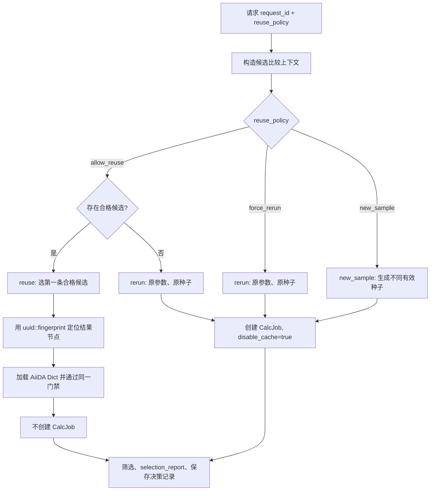

# 复用决策与决策记录

本页说明项目 WorkChain 与团队 AiiDA fork 之间的复用决策接入、候选映射、持久化记录和验证边界。字段口径与 [约定⑤](https://lcnzinmktf6r.feishu.cn/wiki/WRgGwqdcKiqvFNkwqSscY7pMn8c) 对齐，候选结构直接使用 [约定④](https://lcnzinmktf6r.feishu.cn/wiki/YH74w7cq6iZLdVkpVBBcMEtcnlc)。

当前 `ProteinMPNNFilterWorkChain` 通过 `get_reuse_configuration()` 将 `request_id`、`reuse_policy`、候选、决策函数和 `materialization=CONSUME_CANDIDATE` 提交给团队 AiiDA fork；内核产生唯一决策记录后，WorkChain 再核对策略、动作、候选、实际种子和注入结果。2026-11-13 在 Coder 独立环境验证：主项目 15 项 CPU mock 集成检查通过，fork 的 `tests/engine/test_reuse.py` 使用 ZeroMQ 后端 15 项测试通过。2026-11-11 的授权 GPU 三策略复验发生在此次 fork 接入前，仍需在独立 profile 上按新链路复验。

## 内核接入

- fork 仓库：`https://github.com/WuYuhui01/aiida-core.git`，分支 `dev-wyh`，验证提交 `9a1e474f2`，基于 AiiDA 2.9.4。
- `reuse`：内核选择候选后，项目使用 `ReuseMaterialization.CONSUME_CANDIDATE` 注入已有 AiiDA `Dict`，不创建 CalcJob，并继续通过原 schema 与清单门禁。
- `rerun`／`new_sample`：内核明确返回重算动作，项目禁止回退到 AiiDA 原生整进程缓存；`new_sample` 的实际种子必须写入 CalcJob 输入和报告。
- 自定义决策：只能返回用户策略允许的动作；`force_rerun` 只能返回 `rerun`，`new_sample` 只能返回 `new_sample`，`allow_reuse` 可以返回 `reuse` 或 `rerun`。
- 持久化：内核写入决策记录，WorkChain 启动后校验记录恰好一条，并核对 `request_id`、`reuse_policy`、`process_uuid`、动作、候选 UUID 和实际种子。

## 三种策略



- `allow_reuse`：从候选列表按顺序选择第一条 `qualified=true` 的候选。候选为空或全部不合格时，降级为原参数、原种子重算。
- `force_rerun`：忽略候选是否合格，但候选仍完整写入记录；使用原参数、原种子重新运行，并禁止本次缓存命中。
- `new_sample`：忽略候选，生成一个处于 `1..2**32-1` 且不同于原种子的 `effective_seed`；实际种子写入推理参数和报告，并禁止本次缓存命中。
- `reuse`、`rerun` 必须保留原种子；只有 `new_sample` 可以改变种子。

## WorkChain 输入

| 端口 | 类型 | 要求 | 用途 |
| --- | --- | --- | --- |
| `request_id` | `Str` | 与 `reuse_policy` 成对提供 | 约定②的 `req-<UUID>` |
| `reuse_policy` | `Str` | `allow_reuse`／`force_rerun`／`new_sample` | 用户复用选择 |
| `reuse_candidates` | `List` | 可选；元素符合约定④ | 参与比较的候选，包含不合格项 |
| `candidate_results` | `Dict` | 可选；`str -> str` | 从候选唯一定位 AiiDA 结果节点 |
| `decision_function` | `Str` | 可选；`module:function` | 自定义决策器；默认使用三种内置策略 |

启用新链路时，`request_id` 和 `reuse_policy` 必须同时提供；只提供任一决策扩展端口会返回退出码 208。新链路与旧 `existing_mpnn_result` 互斥。新链路还需要 `mpnn_params.seed`，其值必须是 `1..2**32-1` 的非零整数。

候选的 `uuid` 是**结果节点 UUID**，不是上游 CalcJob UUID；候选唯一键为 `(uuid, fingerprint)`。不合格候选必须保留 `reason`，且以 `missing_file`、`format_error`、`insufficient`、`below_threshold`、`not_finished` 或 `manual_reject` 开头。合格候选的 `reason` 必须为 `null`。

## 候选结果映射

`candidate_results` 的键为 `<候选UUID>::<fingerprint>`，值为同一个 AiiDA 结果节点 UUID：

```json
{
  "f9633fef-132c-47d0-b81d-8f3644763518::fe5efe41b0d1fd42":
    "f9633fef-132c-47d0-b81d-8f3644763518"
}
```

复用阶段会用被选中候选的唯一键查映射，加载对应的 `Dict` 结果。结果节点必须存在、类型正确、UUID 与候选一致，并具有可记录的来源过程；随后仍要通过 schema、清单完整性和上游身份门禁。映射缺失、歧义或值不一致时返回退出码 209。

## 决策记录

每次策略决策生成 `ai4s-decision-1` 记录，并写入 WorkChain 节点的 `base.extras["ai4s_decision_records"]`：

```json
{
  "request_id": "req-6f1c2a9e-3b7d-4c51-9a0e-1d2f3c4b5a6e",
  "process_uuid": "2f49ef2c-7e42-4f88-8d54-3320e4cf1f1a",
  "reuse_policy": "allow_reuse",
  "candidate_compare_list": [
    {
      "uuid": "f9633fef-132c-47d0-b81d-8f3644763518",
      "fingerprint": "fe5efe41b0d1fd42",
      "member": "陈思睿",
      "location": "profile://ai4s/f9633fef-132c-47d0-b81d-8f3644763518/design.fa",
      "size_bytes": 2312,
      "elapsed_s": 47,
      "qualified": true,
      "reason": null,
      "note": ""
    }
  ],
  "final_decision": {
    "action": "reuse",
    "selected_candidate_uuid": "f9633fef-132c-47d0-b81d-8f3644763518",
    "effective_seed": 37
  },
  "reason": {
    "reason_code": "R01",
    "reason_text": "策略为允许复用，存在合格候选，按候选顺序选中该候选复用"
  },
  "timestamp": "2026-11-09T08:10:30Z"
}
```

| 理由码 | 策略 | 动作 |
| --- | --- | --- |
| `R01` | `allow_reuse` | `reuse` |
| `R02` | `allow_reuse` | `rerun`（无合格候选） |
| `R03` | `force_rerun` | `rerun` |
| `R04` | `new_sample` | `new_sample` |
| `R05` | 自定义决策器 | 必须在 `reuse_policy` 允许的动作内选择 |

同一 `(request_id, process_uuid)` 重放时替换原记录；同一请求下不同过程 UUID 保留多条记录。查询接口只返回能通过完整结构校验的记录：

```python
from ai4s_workflows.decision import (
    find_decisions_by_process,
    find_decisions_by_request,
)

records = find_decisions_by_request("req-6f1c2a9e-3b7d-4c51-9a0e-1d2f3c4b5a6e")
records = find_decisions_by_process("2f49ef2c-7e42-4f88-8d54-3320e4cf1f1a")
```

## 自定义决策器

`decision_function` 接收包含 `request_id`、`process_uuid`、`reuse_policy`、`candidate_compare_list` 和 `original_seed` 的字典，返回以下四个字段：

```python
def choose(context):
    return {
        "action": "rerun",
        "selected_candidate_uuid": None,
        "effective_seed": context["original_seed"],
        "reason_text": "人工判断现有候选证据不足",
    }
```

将函数放在 daemon 可导入的可信模块中，并配置为 `my_decisions:choose`。自定义决策器只在用户策略允许的动作范围内选择，不能借 `R05` 绕过用户策略：

| `reuse_policy` | 允许返回的 `action` |
| --- | --- |
| `allow_reuse` | `reuse`／`rerun` |
| `force_rerun` | `rerun` |
| `new_sample` | `new_sample` |

包装器会统一写入 `R05` 并再次校验：动作必须符合用户策略，不能选择不合格候选，不能复用换种子，也不能在重跑时改种子。记录读取时还会重复校验策略与动作的对应关系，防止被篡改的历史记录通过查询。自定义模块会在 daemon 进程内导入，只应配置经过审查的代码。

## 运行结果与失败码

复用成功时 WorkChain 不创建 CalcJob：`model_launches=0`、`attempt_count=0`，`selection_report.selected_candidate_uuid` 是结果节点 UUID，`cached_from` 是结果来源**过程** UUID。强制重跑和新采样各自创建 CalcJob；新采样的 CalcJob 参数和 `selection_report.effective_seed` 使用同一个新种子。

| 退出码 | 含义 |
| --- | --- |
| `208` | 复用请求字段不完整、互斥或取值非法 |
| `209` | 已选择候选无法通过 `candidate_results` 唯一定位，或结果节点不可加载／不可记录来源 |

## 验证边界

2026-11-13 在 Coder 独立环境和临时 profile 中验证两条链路：主项目 `python tests/test_aiida_workflows.py` 的 15 项 CPU mock 集成检查通过；fork 的 `python -m pytest -q -o addopts='' --broker-backend=zmq tests/engine/test_reuse.py` 为 15 项通过。fork 测试必须使用 ZeroMQ，因为该独立环境未配置默认 RabbitMQ。

主项目检查覆盖三种策略、真实种子、证据清单、决策记录、daemon 停止与恢复、重试上限、失效清单和 schema 门禁；fork 检查覆盖受控决策、候选结果消费、原生缓存边界和用户策略约束。2026-11-11 的真实 GPU 三策略、R01／R03／R04 决策记录和同一 profile 内候选复用仍然有效，但发生在此次 fork 接入前，不能替代接入后的真实 GPU 复验。真实 daemon 中断恢复、网页实时回显、团队共享 profile 查询与跨成员复用仍未验证。

返回：[C 模块](../README_C.md) · [当前状态](status.md) · [实施计划](implementation_plan.md) · [仓库](../README.md)。
