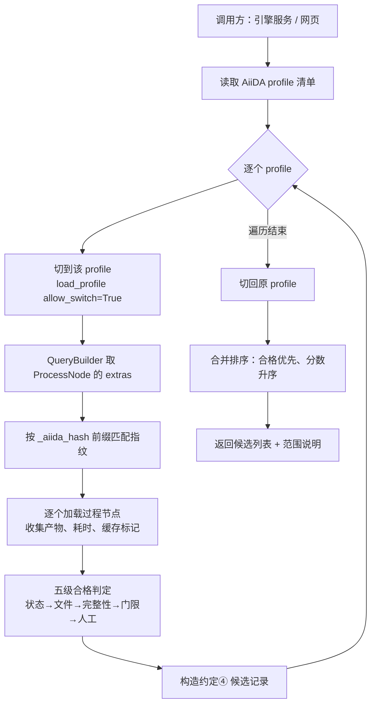

# 任务 4.0 · 跨成员候选查找与查询接口

站 5（跨成员候选查找）· 站 9（来源与决策查询）  
负责人：陈思睿 ｜ 起草的约定：约定④ 候选结果 ｜ 2026-11-11

一句话：把候选查找从「只查本人数据库」扩展到「在共享范围内查所有成员的合格结果」，
并让网页能按 UUID 实时读到来源、产物与决策记录，不再依赖手动导出快照。

| 交付要求 | 对应内容 | 位置 |
|---|---|---|
| a 跨库候选查找与改动说明 | 第 1 节 | `src/ai4s_query/candidates.py` |
| b 共享方式的选择与理由 | 第 2 节 | 本文 |
| c 查询接口及启动方式 | 第 3 节 | `src/ai4s_query/server.py` |
| d 约定④ 示例数据的真实运行记录与验证 | 第 4 节 | `~/runs/task4-demo-*/` |

---

## 1 跨成员候选查找（对应交付 a）

### 1.1 原状与改动

AiiDA 原生的候选查找（缓存命中判断）只查**当前 profile 对应的那一个数据库**。
一人一个 profile 时，这意味着「别人算过的结果找不到」。本模块把查找范围显式扩大：

| 项 | 原生 | 改动后 |
|---|---|---|
| 查找范围 | 当前 profile | profile 清单逐个查，结果合并 |
| 返回内容 | 命中的节点 | 约定④ 的 9 个字段 + 不合格原因 |
| 不合格结果 | 不出现 | 出现，带枚举原因（供 ⑤ 说明「为何未选」） |
| 指纹来源 | 内部比较 | 显式取 `extras._aiida_hash`，可外部核对 |

### 1.2 流程图



### 1.3 三个实现要点（都是实际踩到的）

**① 指纹键是 `extras._aiida_hash`，且界面只显示前 16 位。**

比对必须支持前缀，否则「报告里抄 16 位去查」永远查不到。JSON 路径上的 `like`
在 `sqlite_dos` 后端行为不稳定，因此改为取回 extras 后在 Python 侧比对 ——
节点规模在数百量级，开销可忽略。

**② `load_profile` 默认 `allow_switch=False`。**

跨 profile 查询必然抛 `InvalidOperation: cannot switch to profile ...`，必须显式传
`allow_switch=True`。另一个更隐蔽的坑：切换后，先前加载的节点对象与存储会话脱钩，
再访问 `node.uuid` 会报错 —— 所有属性必须在切换**之前**读完，因此 `by_node()`
先取 `uuid / fingerprint / process_uuid`，再进入查找。

**③ 「仅有值」的结果不是缺文件。**

calcfunction 产出 `Dict`/`Int` 时没有仓库文件。约定④ 明确允许这类结果作为候选
（`size_bytes` 记 0、`note` 写「仅值」），所以「输出节点存在但没有文件」不能判
`missing_file`；只有「过程完全没有输出节点」才是。

### 1.4 判定与枚举

严格按约定④ 3.1 的五级顺序，任一级不过即停：

| 级 | 检查 | 不过时的枚举 |
|---|---|---|
| 1 | 过程 `finished` 且 `exit_status = 0` | `not_finished` |
| 2 | 有输出节点；文件可读且非空 | `missing_file` / `format_error` |
| 3 | 序列条数 ≥ 请求的 `num_sequences` | `insufficient` |
| 4 | 最优分数 ≤ 请求阈值（分数越低越好） | `below_threshold` |
| 5 | 人工复核 | `manual_reject` |

---

## 2 共享方式的选择（对应交付 b）

两条路，本轮二选一。

| 维度 | A 多库查找 | B 共用数据库（PostgreSQL） |
|---|---|---|
| 改造范围 | 引擎侧维护 profile 清单，逐个查询 | 全员迁移到同一个库，靠 `user_id` 区分成员 |
| 数据迁移 | 无 | 需导出导入，现有节点全部重编号 |
| 三天内可交付 | 可以 | 不可以（要改全员 profile、装 PG、重灌数据） |
| 查询代价 | N 个库各查一次，串行 | 一次 SQL，天然跨成员 |
| 一致性 | 各库独立，无跨库事务 | 单库事务 |
| 后续扩展 | 新增成员即新增 profile | 新增成员即新增 DB 用户 |

**结论：本轮选 A（多库查找）；终态建议 B。**

理由三条：

1. **与现状一致**。当前每人一个独立 `sqlite_dos` profile，A 不需要任何人改动自己的环境，
   也不需要迁移已有节点；B 需要全员配合，与验收时间冲突。
2. **约定④ 已经预留了跨库语义**。`location` 的格式是
   `profile://<profile>/<节点UUID>/<仓库路径>`，第一段就是 profile 名 —— 说明跨库
   是被预期的形态，而不是绕路方案。
3. **接口不变**。站 9 的端点和 ④ 的字段与选型无关；将来换成 B，只需把「profile 清单
   收敛成一个」，调用方无感知。

**什么情况下改选 B**：出现以下任一即应迁移 —— ① 成员数超过 10 人，串行查询成为瓶颈；
② 需要跨成员的事务或聚合统计（如按模型版本统计复用率）；③ 需要按参数内容检索历史
（PG 的 JSONB + GIN 是 SQLite 给不了的能力）。

---

## 3 查询接口与启动方式（对应交付 c）

### 3.1 启动

```bash
# 容器内（Coder）
cd ~/ai4s-workspace
export PYTHONPATH=$PWD/src
~/.venvs/aiida/bin/python -m ai4s_query.server --port 8848 --profile ai4s

# 本地
python -m ai4s_query.cli serve --port 8848
```

只依赖标准库（`http.server` + `json`），不引入 Web 框架，与工作台后端保持一致。
服务只读：不写节点、不改属性、不触发重算。

### 3.2 端点

| 方法 | 路径 | 参数 | 返回 |
|---|---|---|---|
| GET | `/api/health` | — | 当前 profile、profile 清单、成员映射、决策记录目录 |
| GET | `/api/node/<UUID>` | UUID 全量 / 前 8 位 / PK | 状态、参数值、产物与 sha256、血缘、缺失信息 |
| GET | `/api/trace/<UUID>` | `depth`（默认 12） | 主干轨迹：输入 → 计算 → 产物 |
| GET | `/api/candidates` | `fingerprint`、`node`、`profiles`、`num_sequences`、`score_threshold`、`include_unqualified` | 约定④ 候选列表 + 范围说明 |
| GET | `/api/decision` | `request_id`、`process_uuid`、`uuid` 任一 | 约定⑤ 决策记录 + 逐条校验结果 |

统一返回 JSON，`Access-Control-Allow-Origin: *`，错误按 400 / 404 / 500 区分。

五个端点的真实响应快照在 [task4-api-examples/](task4-api-examples/)，前端可直接对照字段，
不必等环境跑起来（`01-health` / `02-node` / `03-trace` / `04-candidates` / `05-decision`）。

### 3.3 给站 10（网页）的对接约定

1. **字段名直接用 ④ ⑤ 的键名**：候选 `uuid / fingerprint / member / qualified / reason`，
   决策 `request_id / process_uuid / reuse_policy / candidate_compare_list /
   final_decision / reason / timestamp`。
2. **候选列表里 `qualified = false` 的记录必须显示**，并展示 `reason`；验收要求
   「不合格结果带原因列出，不会被选中」。
3. **不要在前端判断合格性**。判定在内核侧完成，前端只渲染。
4. 决策记录缺失时接口返回 `missing` 文案，前端按「尚无记录」展示，不要报错。

---

## 4 真实运行记录与验证（对应交付 d）

### 4.1 环境

两个 profile 模拟两位成员（任务书允许的开发期替代）：

| profile | 成员 | 存储 |
|---|---|---|
| `lab` | 陈思睿 | `aiida_lab/storage` |
| `lab2` | 吴昱慧 | `aiida_lab2/storage` |

两边用**同一段输入**运行同一计算：序列 `MKTAYIAKQRQISFVKSHFSRQ`（22 残基），
过程 `seq_stats`。

### 4.2 记录一：跨成员命中

命令：

```bash
python -m ai4s_query.cli candidates --node 170
```

输出（节选）：

```
指纹 2a20461daa76ff27705dbf439799ce67e64191585ffdffa7e0738a63dae8ba2e
范围 multi-profile：lab、lab2
候选 13 条，其中合格 13 条

成员     合格   产物                                        大小      耗时  原因
--------------------------------------------------------------------
陈思睿    是    lab/de4ba3d8-8c52-4762-9245-63...          0     0.3
...
吴昱慧    是    lab2/cf51c226-1402-4d72-af26-3...          0     0.2
```

要点：`lab2` 的过程（`cf51c226…`）与 `lab` 的过程指纹完全相同，被同一次查询找到 ——
这就是「一位成员的结果能被另一位成员找到」。

### 4.3 记录二：不合格结果带原因

用一个**故意失败**的过程作参照（阈值 100 > 序列长度 22，指纹前 16 位 `58ac75080ee00308`）：

```
候选 5 条，其中合格 0 条

成员     合格   原因
--------------------------------------------------------------------
lab    否    not_finished: ValueError: 序列长度 22 小于阈值 100，该设计不可用
lab    否    not_finished: ValueError: 序列长度 22 小于阈值 100，该设计不可用
...
```

要点：不合格结果**照样列出**，并给出枚举 + 原文；`qualified=false` 的记录不会被
决策层选中。

### 4.4 记录三：决策记录可读、可校验

```bash
python -m ai4s_query.cli decision req-6f1c2a9e-3b7d-4c51-9a0e-1d2f3c4b5a6e
```

```
查询 req-6f1c2a9e-3b7d-4c51-9a0e-1d2f3c4b5a6e：1 条决策记录

  请求 req-6f1c2a9e-3b7d-4c51-9a0e-1d2f3c4b5a6e
  过程 de4ba3d8-8c52-4762-9245-6390748c51ca
  选择 allow_reuse  →  动作 reuse（候选 8 条）
  理由 R01 策略为允许复用，存在合格候选，按规则选中第一条（成员 吴昱慧）
  时间 2026-11-11T08:48:58Z    校验 通过
```

要点：选中项 `cf51c226…` 属于**另一位成员**，即「跨成员复用」的完整证据链：
候选在 A 的库里 → 决策选中它 → 记录可按 `request_id` 查回。

### 4.5 对照约定④ 第 7 节验收清单

| ④ 的验收项 | 本实现如何满足 | 证据 |
|---|---|---|
| 凭 UUID 可查到节点、输入参数与产物 | `/api/node/<UUID>`、`show` 子命令 | 4.2 |
| 指纹可独立复算，结果一致 | 指纹直接取 `extras._aiida_hash`，不自行重算 | 4.2 |
| 位置能实际打开文件，大小与文件一致 | `location` = `profile://<profile>/<uuid>/<路径>` | 4.2 |
| 合格判定有明确依据，不合格项均有枚举原因 | 五级判定 + 六种枚举 | 4.3 |
| ⑤ 中每次「未复用」都能对应到具体候选与原因 | 候选列表含 `qualified` 与 `reason`，⑤ 直接引用 | 4.4 |

---

## 5 边界与遗留

1. **profile 切换是进程级全局状态**。服务内用互斥锁串行处理查询，因此并发上限为
   1；演示与联调够用，生产应改为「每库一个只读连接池」或迁移到共用数据库。
2. **指纹前缀匹配在 Python 侧完成**，复杂度 O(节点数/profile)，当前规模（数百）
   无影响；上万节点后应改为按完整指纹建索引。
3. **约定⑤ 的存放载体尚未定稿**。查询接口做成适配层：先读过程节点 attributes 的
   `ai4s_decision`，找不到再读旁路目录（默认 `~/runs/decisions`）。载体定下来后只改
   `decision.py`，接口不变。
4. **候选目前来自原生 calcfunction 过程**。真实 ProteinMPNN 的 CalcJob 节点由 A 侧
   产出，接上之后同一套代码直接可用（指纹键、产物遍历、判定逻辑都与节点类型无关）。
5. **耗时字段**取过程 `ctime→mtime`；缓存命中记 0。若 ⑤ 需要区分「排队」与「执行」，
   要拆成两列（已在 ④ 文档中标注为待确认项）。
